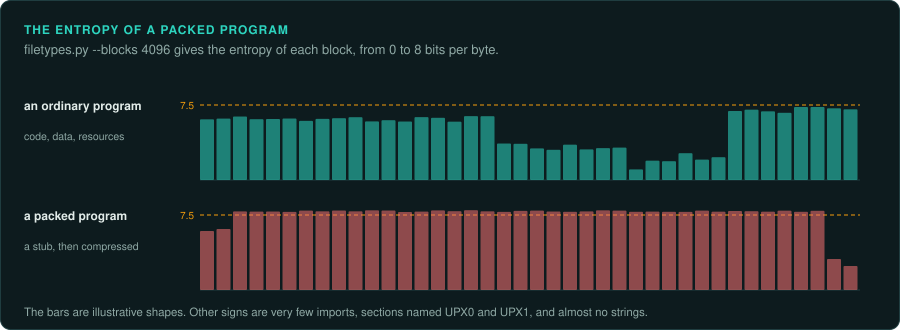
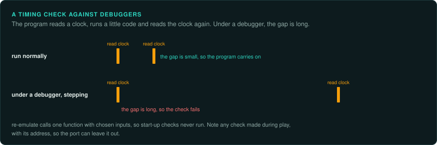
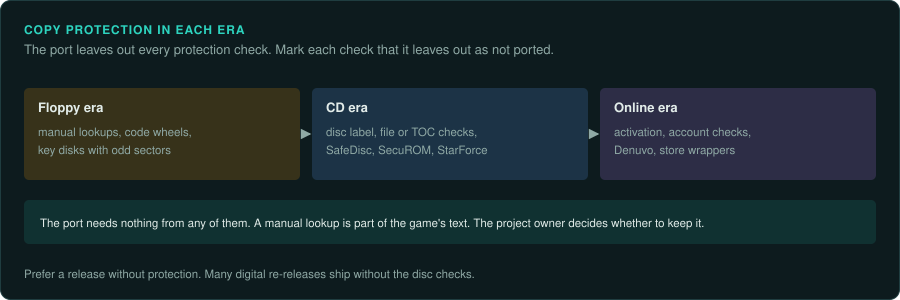

# Packed and protected code

Some executables do not hold their code in readable form. A packer compresses the program and
adds a small routine that unpacks it in memory at start-up. A protection system encrypts parts
of the code, checks for the original disc or a debugger, or binds the program to an online
account. This page describes how to recognise each case, and what it means for the work. It
describes the techniques as facts. It does not describe how to defeat a commercial protection.
The law on working around copy protection differs by country ([Legal](../LEGAL.md),
[the law worldwide](../preservation/law/README.md)). You decide which route to take.

## Recognising a packed program

| Sign | Where to see it |
|---|---|
| A packer's name or mark in the first kilobyte (`LZ91`, `PKLITE`, `UPX!`) | `filetypes.py`, `dosinfo.py`, `peinfo.py` |
| Entropy above 7.5 over most of the file | `filetypes.py --blocks 4096` |
| Very few imports, often only `LoadLibrary` and `GetProcAddress` | `peinfo.py --imports` |
| Section names such as `UPX0` and `UPX1`, or a section that is both writable and executable | `peinfo.py` |
| An entry point in the last section, or a DOS entry near the end of the load image | `peinfo.py`, `dosinfo.py` |
| Almost no readable strings, then many once the program has started | `strings`, a memory dump |
| Ghidra finds a few functions and a large block of data | The Ghidra export |

Packers seen on DOS games include EXEPACK (from Microsoft's linker), LZEXE, PKLITE and DIET.
Windows games used UPX, ASPack and PECompact. A DOS extender such as DOS/4GW is different. There the game is a 32-bit LE program bound to a small real-mode loader. Its code is readable once the LE
part is separated ([DOS games](../DOS.md)).

## Getting the code out

1. **Use the packer's own tool when there is one.** `upx -d` restores a UPX program exactly.
   UNP and similar tools restore the common DOS packers.
2. **Let the program unpack itself, then dump the memory.** Run it in an emulator until the
   unpacking routine jumps to the real start of the program (the original entry point). Then
   save the memory. DOSBox-X's debugger can stop at that jump and dump memory
   (`tools/dos/dbx_control.py` drives it from a script). Unicorn, through `tools/emu`, can do
   the same for a program GameFrame can load.
3. **Load the dump into Ghidra.** Give it the dump as raw memory at the right base address.
   Record the address of the real entry point and the state at the moment of the dump.

`tools/ghidra/AddMemoryBlocks.java` loads a dump, or several pieces of one, at their addresses
([Getting more from Ghidra](../working/ghidra.md#code-that-is-not-an-executable-file)).
Record which way you took, and the hash of the dump, so another person can repeat it. The
unpacked code is game material and stays in `analysis/` or `derived/`.

## Obfuscated data

Data files can be hidden too. [Identifying unknown files](files.md#simple-obfuscation) covers the
weak schemes that `xorscan.py` finds. Stronger schemes need the decoder in the code. Signs of
the decoder are a loop over a buffer straight after a file read, constants used as keys, and
XOR, rotate or add instructions in a tight loop. `constants.py` finds the known ciphers and
hashes by their constants. Another way to get the plain data is to let the game decode it.
Stop the game, or an emulated call of the decoder, just after the loop ends, and save the
buffer. Port the decoder like any other function,
with its constants and its order of operations, and check it with `re-emulate`.

## Obfuscated code

Some protection systems also change the code itself, so that it is hard to read.

- **Control flow flattening.** Every block of a function becomes a case of one big `switch`
  inside a loop. A state variable chooses the next block. Ghidra shows one loop with many
  cases and no visible structure.
- **Opaque predicates.** Conditions whose result never changes, such as a test of a value that
  is always even, guard jumps into junk code that never runs.
- **Junk instructions.** Instructions with no effect, and jumps into the middle of other
  instructions, confuse a disassembler.
- **Virtualised code.** The protected functions are translated into the instructions of a
  private virtual machine, with an interpreter in the program. VMProtect and Denuvo work this
  way.

In games, this kind of code usually belongs to a protection system wrapped around the game,
and the game's own code stays readable. Find where the protection ends and the game begins. Leave the protection alone. If a game's own rules sit inside virtualised code, the usual
route is to measure the function from outside. Call it with chosen inputs and record the
outputs ([re-emulate](../../.claude/skills/re-emulate/SKILL.md)).

## Checks against debuggers and emulators

Some games check whether they run under a debugger or have been changed. Common checks are:

- **Timing.** Read a clock before and after a short piece of code. A debugger stepping through
  makes the gap long.
- **The debugger's own traces.** On Windows, `IsDebuggerPresent` and fields of the process
  environment block. On DOS, the vectors of interrupts 1 and 3, which a debugger takes over.
- **Checksums of the program's own code.** Patched code or a software breakpoint changes the
  sum.
- **Emulator details.** CPU identification values, timing of instructions, or devices that a
  given emulator lacks.

These checks rarely matter for GameFrame's method. `re-emulate` calls one function with
chosen inputs, so the start-up code that runs the checks does not run. When a game checks its
own code during play, note the check, its address and what it covers. Then the port knows it
can leave the check out.

## Copy protection

| Era | Kinds | What the port needs |
|---|---|---|
| Floppy era | Manual lookups, code wheels, key disks with unusual sectors | Nothing from a disk check. A manual lookup is part of the game's text and screens. The owner of the project decides whether to keep it |
| CD era | Disc checks (volume label, a file's presence, the disc's table of contents), SafeDisc, SecuROM, StarForce | Nothing. Mark the check as not ported |
| Online era | Activation, account checks, Denuvo, store wrappers | Nothing. Work from a release without them where one exists |

The port reimplements the game. Protection is not part of the game. Mark each check the
port leaves out with a "not ported" note at the place it would have run, so the ledger lists
it ([re-port](../../.claude/skills/re-port/SKILL.md)). Prefer a release that has no protection.
Many digital re-releases ship without the disc checks. `compare_trees.py` and `similar.py`
show whether such a release is otherwise the same program.

## What to record

- For each executable: packed or not, by what, and how you got the code out.
- The real entry point and the base address of any dump, with the dump's hash.
- Each check found (debugger, integrity, disc, online), its address, and how the port treats it.
- Each data decoder, with its key and its function.
