## Ask your agent

Run and capture the original. Copy this prompt into your coding agent:

```text
In my GameFrame project, get the original game running where we can watch and capture it.

1. Read docs/observe/running-the-original.md and the re-observe skill.
2. Pick the environment for this game (GameFrame's emulators, DOSBox-X, Wine, a console
   emulator). Tell me what it needs before you install anything.
3. Write a script that starts the game, plays a fixed input and saves frames and state.
4. Record next to each capture the game version, the settings, the seed and the inputs.
5. Keep every capture in the ignored derived/ folder.
```

# Observing the original

These pages describe how to run the original game, watch it, drive it and capture what it
does, so each claim about the port can cite a measurement. Read them after you have used the
[taxonomy](../games/README.md) to find what kind of game you have.

- [Running the original](running-the-original.md): where to run it, what to capture, how to
  drive it by script, how to compare.
- [Emulators as instruments](emulators.md): save states, input movies, RAM maps, comparing the
  port with the original frame by frame with `ramdiff.py`, and community records of games.
- [Inputs](inputs.md): every kind of input from outside, where each is read, and how a port
  takes them through one entry point.
- [Capturing the interface](ui.md): why game interfaces are custom, how to inventory every
  screen, and how to capture and rebuild them.
- [Tracing calls to the system](system-calls.md): logging the files, clock, sound and
  libraries the original uses, with Wine, Process Monitor, strace and proxy libraries.
- [Debugging the original](debuggers.md): debuggers and GDB stubs for each kind of game,
  Ghidra's debugger and emulator, and patching a copy.
- [Capturing what the game draws](drawing.md): apitrace, RenderDoc and dgVoodoo 2; draw
  order, textures, geometry and matrices from the original.
- [Network games](network.md): capturing a protocol, reading its messages with `pcap.py` and
  `fields.py`, and checking a rebuilt server or client.
- [Finding values in memory](memory.md): scanning memory dumps for a value you can see,
  confirming the address, and finding the structure around it.
- [A model to query](object-model.md): an object model of the game, like a web page's, with
  entry points for queries, input, time and capture, in both the original and the port.
