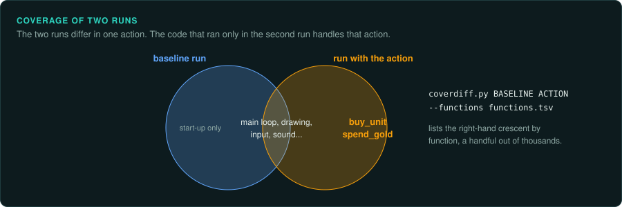

# Debugging the original

A debugger stops the original game at a chosen instruction or when a chosen value changes, and
shows its registers and memory at that moment. It answers questions that reading the code
cannot settle quickly: which of three functions runs when a unit dies, what a table holds once
the level has loaded, which code writes the score. This page lists the debuggers for each kind
of game, and how to connect Ghidra's debugger to an emulator.

## Debuggers by kind of game

| Game | Debugger | Notes |
|---|---|---|
| DOS | DOSBox-X's debugger | Breakpoints on addresses, interrupts and memory changes, memory dumps. `tools/dos/dbx_control.py` drives it from a script |
| DOS, early PC, booters | Bochs | A built-in debugger. Bochs can also be built with a GDB stub |
| Any PC, raw machine | QEMU | `-s -S` waits for a GDB connection on port 1234 before it starts |
| Windows | x64dbg, WinDbg | On Windows itself. Under Wine, `winedbg --gdb game.exe` serves the process to GDB |
| Arcade and many consoles and computers | MAME | A built-in debugger with memory views and watchpoints. `-debugger gdbstub` serves GDB for some CPUs |
| Game Boy Advance | mGBA | `-g` starts a GDB stub |
| Nintendo DS | DeSmuME | `--arm9gdb=PORT` and `--arm7gdb=PORT` start GDB stubs for the two CPUs |
| GameCube and Wii | Dolphin | A built-in debugger, and a GDB stub on some builds (set in its configuration) |
| PlayStation | PCSX-Redux | A built-in debugger, and a GDB server in its settings |
| Other consoles | The emulator's own debugger | The page for each console lists them ([Console games](../consoles/README.md)) |

Each debugger has its own commands. The parts that matter most are the same everywhere.

- **Memory breakpoints** (watchpoints) stop when an address is written or read. Use them with
  [Finding values in memory](memory.md): find the address of the score, then stop at the code
  that changes it.
- **Conditional breakpoints** stop only when a condition holds, such as a register value.
- **Logging breakpoints** print registers or memory and carry on without stopping. A series
  of them gives a trace of values over time. Compare that trace with the port's own trace
  using `tools/verify/seqdiff.py`.
- **Memory dumps** save a region to a file for `memscan.py`, Ghidra or a decoder.

## Ghidra's debugger

Ghidra 10 and later include a debugger. It shows the running program inside the same listing
and decompiler you use for reading, with your labels and types. It connects to GDB, LLDB and
WinDbg. Through GDB it reaches any GDB stub in the table above. Start the emulator with its stub,
then use Ghidra's GDB launcher with a remote target (`target remote localhost:PORT`). The
addresses in the emulator must match the addresses of the program in Ghidra. For a game that
loads at a fixed address, they match. For a program that moves, Ghidra maps the module by its
base address.

Ghidra records the session as a trace that you can step back through. A memory value or
register can be followed back to the instruction that set it.

## Ghidra's emulator

Ghidra can also run code without the game, with its P-Code emulator (`EmulatorHelper` in a
script, or the Emulator in the debugger). It runs any processor Ghidra can decompile:
68000, MIPS, SH-2, Z80, 6502, ARM and others. For those processors it can take the place of
Unicorn in [re-emulate](../../.claude/skills/re-emulate/SKILL.md). Set the registers and memory,
run one function, and read the result. It is slower than Unicorn and needs the same care with
the hardware the function reads.

## Code coverage: what runs when



A game runs most of its code every frame. The code for one action, such as buying a unit,
saving or opening a door, runs only when that action happens. Coverage shows it. Record which
basic blocks run while you play without the action. Then record again, doing the same and the
action once. The blocks in the second run and not the first are the action's code.

- **Recording.** DynamoRIO's drcov tool (`drrun -t drcov -- game.exe`) writes a coverage log
  on Windows and Linux. Frida scripts write the same format. On a console or DOS emulator, a
  debugger that logs executed addresses gives a list to use instead.
- **Comparing.** `tools/triage/coverdiff.py BASELINE.log ACTION.log --module game.exe --base
  0x400000 --functions analysis/export/game.exe/functions.tsv` lists the functions that ran
  only with the action, by name.
- **Viewing.** Coverage plug-ins for Ghidra (such as Cartographer) and IDA (Lighthouse) colour
  the blocks that ran in the listing.

Keep the two runs alike: the same save, the same menus, the same length. Every extra
difference adds functions to the list.

## Tracing calls in the running game

`tools/live/frida_trace.py` traces calls to chosen functions while the game runs on its own
platform. Name each function by module and offset, or by export:

```bash
.venv/bin/python tools/live/frida_trace.py --hook 'game.exe+0x1a2b30=rng_next' --args 1 \
  --out derived/live.trace --attach game.exe
tools/verify/seqdiff.py derived/live.trace derived/port.trace
```

Each call is one line with its label, its first arguments and its call site. The format is the
one `tools/emu/call_trace.py` writes, so `seqdiff.py` compares the trace with the port's. Use it
for what the emulator cannot reach: a whole level played by hand, calls that depend on the
graphics or sound system, and timing between frames. `--watch 'game.exe+0x2a1000:256=units'`
logs each read and write of a block of memory with the instruction that made it, which finds
the code behind a value seen in a memory scan. Frida is installed by
`scripts/setup.sh --install`. It runs on Windows, Linux, macOS and Android. Some protected games
detect it. On macOS, signed programs need a copy without the hardened runtime.

## Adding code to the original

Some answers need code inside the original game. Examples are writing the game state to a
file every frame, or logging each message a function sends. On your own copy, for analysis
only, there are three ways in:

- **Frida**, above. It needs no change to the files and is the first choice.
- **A proxy DLL.** Windows loads a DLL from the game's folder before the system's copy. A DLL
  named like one the game imports (`dinput8.dll`, `d3d9.dll`, `winmm.dll`) can pass every call
  on to the real one and log what it needs. Graphics tools such as apitrace work this way.
- **A code cave.** Unused bytes in the executable, often padding at the end of a section, can
  hold a few new instructions. A jump placed over an existing instruction leads there. The new
  code repeats the instruction it replaced, does its work, and jumps back. Record each change
  as for any patch.

## Going backwards: time-travel debugging

A recording debugger saves everything a program does, then lets you step backwards as well as
forwards. The common question becomes one step. A value is wrong now, so which instruction
last wrote it? Set a watchpoint on the value and run backwards.

- **WinDbg's Time Travel Debugging** records a Windows process into a trace file. Queries over
  the trace list every call to a function, or every write to an address, across the whole run.
- **rr** records a Linux x86 process. `gdb` then runs over the recording with `reverse-continue`
  and `reverse-step`.
- **Emulators.** Many console and computer emulators can rewind, and some write a trace log of
  every instruction. A save state taken just before the moment, with a trace log, gives the same
  answer for older games.

A recording is large and the program runs slower while it records. Record only the few seconds
around the event, starting from a save that reaches it quickly.

## Following a value: taint

Coverage shows which code ran. Taint shows which code used a value. Mark some bytes as the
source: a field read from the save file, the result of the random generator, a key press. Then
follow each instruction. When an instruction reads a marked byte, the bytes it writes are
marked too. At the end, the marked memory and the instructions that touched it are the value's
path through the game.

- **Questions it answers.** Which code reads this byte of the save file? Which decisions does
  this random draw affect? Which part of the score comes from the difficulty setting?
- **Tools.** libdft (on Intel Pin) taints a running x86 program on Linux. On other platforms,
  use an emulator. `tools/emu/mem_trace.py` marks memory in `pe_emu.py`, calls a function, and
  lists each instruction that read or wrote the marked bytes. With `registers=True` it also
  follows values through registers, using Capstone to know what each instruction reads and
  writes, and marks the memory they reach. It can mark too much, never too little.
- **Several sources at once.** Give each source its own colour (a bit in the mark). One pass
  then shows which values come from the save file, which from the random generator, and which
  from both.
- **The static view.** Ghidra's decompiler can highlight a variable's backward slice: every
  earlier operation that helped compute it. The forward slice shows everything it later
  affects. A slice covers one function and every possible path. Taint covers one run across
  the whole program.
- **Limits.** Taint follows data. It does not follow a decision. If the value only chooses a
  branch, the values written in that branch are not marked. Mark the branch's condition as a
  second source when that matters. Tables indexed by a marked value spread the mark widely, so
  start with few marked bytes.

## Solving for an input: symbolic execution

Symbolic execution runs code with unknown inputs. It keeps each value as a formula of the
inputs. At each branch it records the condition. A solver such as Z3 then finds inputs that
make a chosen path run. angr and Triton do this for x86 and other processors.

It suits small pieces of code with a clear goal: a password or level code check, a checksum
over a save file, a key derived from a serial number, a branch that the tests never reach.
It can also show that a branch can never run, when the solver finds no input that reaches it.
Run it on one function at a time, with the memory it needs set up. Whole games are too large.
The number of paths doubles at each branch that depends on an input. The result is an input
that you then try in the original. The solver's answer is evidence only after that run
([Passwords, level codes and cheat codes](../GAME-PATTERNS.md#passwords-level-codes-and-cheat-codes)).

## Patching a copy

Some questions are quicker to answer by changing the game. Examples are skipping a long intro
on every test run, or forcing a level to load first. Patch a copy, never the copy you analyse
([Handling the game as evidence](../working/evidence.md)). Record each patch with its address,
the old and new bytes, and its reason. Patches that defeat copy protection are a different
matter ([Packed and protected code](../media/protection.md)).

## What to record

- The emulator or debugger, its version, and the commands or script that set the breakpoints.
- For each answer, the breakpoint, the address it stopped at, and the values seen.
- Any patch to a copy, as above.
