# Capturing what the game draws

A game that draws with a graphics API (Glide, DirectDraw, Direct3D, OpenGL) hands every
triangle, texture and matrix to that API. A tool between the game and the API records those
calls. The recording shows what the original drew in a frame, in what order and with which
state. That is measured evidence for the port's renderer. It also checks texture and model
decoders against the original. [3D accelerators](../hardware/graphics-3d.md) describes the
APIs themselves.

## Tools

| Tool | APIs | Use |
|---|---|---|
| apitrace | OpenGL, and Direct3D up to 11 | Records every call into a trace, replays it, and shows the state, textures and buffers at any call. Its command line suits scripts |
| RenderDoc | Direct3D 11 and 12, Vulkan, OpenGL 3.2 and later | Captures one frame in full detail: each draw, its textures, its vertex data, its shaders, and the result after it |
| dgVoodoo 2 | Glide, DirectDraw, Direct3D 2 to 9 | Runs old games on Direct3D 11 or 12. A RenderDoc capture then shows what the old game drew |
| Wine's debug channels | Direct3D through Wine | `WINEDEBUG=+d3d` and its relatives log the calls Wine receives ([Tracing calls to the system](system-calls.md)) |
| Emulator video debuggers | Console and arcade video chips | Tile, sprite and palette viewers, per frame |

## What to take from a capture

- **Draw order and state.** The sequence of draws, with blending, depth testing and texture
  stages. The port must draw in the same order where it shows, as with transparent objects.
- **Textures.** Each texture as uploaded, with its format and size. Compare with the port's
  decoder output for the same asset, pixel by pixel.
- **Geometry.** Vertex buffers with positions, normals, texture coordinates and colours. They
  confirm a model decoder and the vertex layout.
- **Matrices.** The world, view and projection matrices of each draw give the camera's
  position, angle and field of view at that frame. The port's camera can be checked against
  them.
- **Per-frame counts.** Draws, triangles and texture changes per frame show which objects
  are drawn and which are culled, and so which level of detail was chosen.

## Comparing with the port

Capture the same frame in both, from the same saved game and the same camera. Then compare
draw by draw. Where the frames differ, the first draw that differs points to the cause, such as a missing object, a different texture or the wrong blending. A software-rendered game has no
API to capture. Compare its frame buffer instead ([Pixel-exact software rendering](../hardware/software-rendering.md)).

Captures hold the game's textures and models. Keep them in `derived/`.
