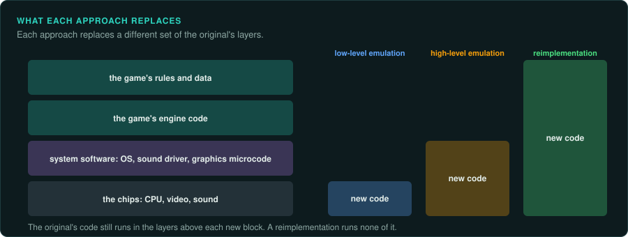

# Emulators as instruments

For a console, arcade or home computer game, an accurate emulator is the best laboratory
there is. It runs the original exactly, it can stop at any instruction, and it can save its
whole state and replay inputs frame by frame. Speedrunners, tool-assisted speedrun (TAS)
authors and ROM hackers have used these features for decades, and their methods suit a
reimplementation well. This page covers using an emulator to measure the original, comparing
the port with it frame by frame, and the community's records of games. [Running the
original](running-the-original.md) lists the emulators. GameFrame's own emulators for single
functions are in [re-emulate](../../.claude/skills/re-emulate/SKILL.md).

## What a good emulator gives

| Feature | What it is for |
|---|---|
| Save states | A starting point that loads in the same state every time: the start of a level, the moment before a boss. Every experiment begins from one |
| Input movies | A recording of the controller input for each frame from power-on or from a save state (BizHawk `.bk2`, FCEUX `.fm2`, Dolphin `.dtm`, Mesen and others). Played back, the run repeats exactly |
| Frame advance | One frame at a time, to see what changes in each |
| Memory viewer, RAM watch and RAM search | Finding where a value lives: search for a value, change it in the game, search again ([Memory](memory.md)) |
| Breakpoints on reads, writes and execution | The code that changes a value. Set a write breakpoint on the address of the player's health, and take a hit |
| Trace logger | Every instruction executed, with registers, for a stretch of frames. Two traces compared show where two runs part |
| Code and data logger | Which bytes of the ROM ran as code and which were read as data, over a play session. It separates code from data for the disassembler |
| Scripting (Lua in BizHawk, Mesen, FCEUX and others) | Reading memory each frame and writing it to a file, drawing overlays, pressing inputs. Most measurements here are scripts |
| Accuracy | Cycle-accurate emulators (Mesen, bsnes in accuracy mode, Ares) behave like the hardware, including its bugs. Faster ones can differ in timing, and a measurement of timing taken on them may be wrong |

## Ground truth, frame by frame

The strongest check of a port of a console game is to run the same inputs in both and compare
the game's state after every frame:

1. **Record a run in the emulator.** Play, or use an existing TAS movie that covers much of
   the game. TASVideos publishes movies for thousands of games, which reach late levels and
   use unusual mechanics.
2. **Dump the state each frame.** A script writes the work RAM (and any other memory the
   rules use) to a file after each frame. Keep the dumps in `derived/`. They are game
   material.
3. **Run the port on the same inputs.** The port reads the movie's inputs, and after each frame
   writes its state in the original's layout: the same addresses, sizes and byte order. This
   is the reason to keep a mapping from the port's variables to the original's addresses.
4. **Compare.** `tools/verify/ramdiff.py ORIGINAL PORT --size N --map ram.map` prints the first
   frame and the first addresses that differ, named from the RAM map. Fix that first
   difference, run again, and repeat. Later differences are often the same one spreading.

This finds mistakes long before anyone would see them on screen, and it keeps working as a
test: a recorded movie and its dumps in a test that runs on every change. Leave out the
addresses that are allowed to differ (`--ignore`): the stack, buffers the port does not keep,
counters it holds elsewhere.

For PC games the same method applies with the game's own demo recordings, a save game as the
starting point, and the port's state compared with memory dumps of the original
([Inputs](inputs.md), [Memory](memory.md)).

## High-level and low-level emulation

An emulator copies the hardware at some level. The choice matters for a port too, because the
port must replace the same hardware:

- **Low-level emulation** reproduces each chip: the CPU instruction by instruction, the video
  chip line by line, the sound chip sample by sample. It needs no knowledge of the game.
- **High-level emulation** reproduces what a piece of software running on the hardware does,
  rather than the hardware itself: the sound driver's commands, the operating system's calls, a
  graphics microcode's display lists. It is faster, and it is how the N64 and later consoles
  were first emulated. It is only as accurate as the knowledge of that software.

A reimplementation is the highest level of all: it reproduces the game's rules and replaces
every chip with modern code. Its hardware layer makes the same choices one part at a time
([Porting console games](../consoles/porting.md)). Where an emulator's source shows how a chip
behaves, use it as a reference for that chip. Its licence decides whether its code can be
reused.

## Community records

Many games have been studied in public for years. Search before measuring:

| Resource | What it holds |
|---|---|
| Data Crystal (datacrystal.tcrf.net) | RAM maps, ROM maps, text tables and notes for many console games |
| The Cutting Room Floor (tcrf.net) | Unused content left in games: levels, graphics, text, debug menus, and the codes that reach them |
| TASVideos (tasvideos.org) | Input movies, game resources pages on mechanics and memory addresses, and accurate emulator settings |
| Speedrun community wikis and documents | Precise mechanics: frame windows, damage formulas, random number manipulation |
| ROM hacking sites and disassembly projects | Annotated disassemblies, editors, and the formats of levels and graphics |

Treat each as a lead to confirm in the binary or the emulator, as any outside claim
([Evidence](../working/evidence.md)). Record what you used in the evidence log, with the page.
Unused content is part of the original: decide with the project whether the port keeps it,
and record the decision.
