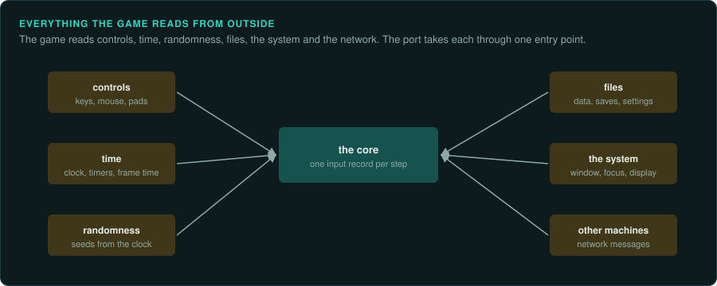
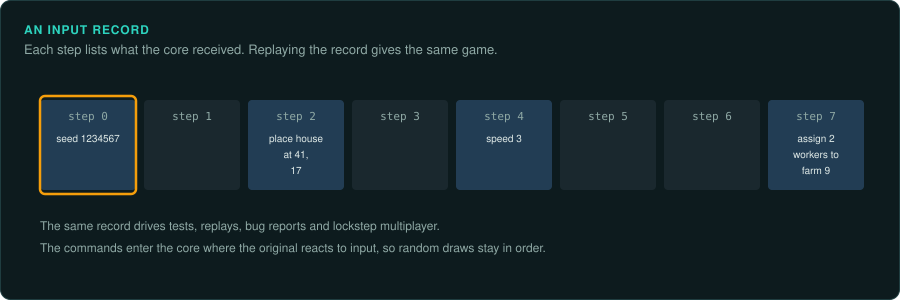

# Inputs: everything that comes from outside

A reimplementation is exact when it gives the same results as the original for the same
inputs. To check this, you must know every input. Besides the keys the player presses, that includes the clock, the files, the
hardware the game detects and the order the operating system delivers events. This page lists
the kinds of input, where you will find each in a game's code, and how to handle each in a
port.

**Every input enters the port through one entry point**, as a record per frame (real-time
games) or per command (games that wait). Then a recording, a demo or a test script can drive the port. Two runs with the same records give the same results. An input that reaches the
game's rules any other way makes two runs differ. A recording cannot repeat it.

## Ask your agent

List every input. Copy this prompt into your coding agent:

```text
In my GameFrame project, list every input the game reads from outside.

1. Read docs/observe/inputs.md.
2. Search the decompile for the signatures it lists: interrupts, ports, API imports, clock
   reads, file opens and network calls.
3. For each input, write the address that reads it, what it reads and how often, in a table in
   docs/FINDINGS.md.
4. Propose the port's input record: one record per frame or per command. Mark which inputs
   change the rules and which only change the presentation.
```

## How games read input

There are two patterns. Many games use both.

| Pattern | What it looks like | What to record |
|---|---|---|
| **Polled state** | An interrupt handler or the message pump writes key and button state into a table; the frame reads the table at fixed points | The table's contents at each read |
| **Events** | A handler acts on each key press or click as it arrives (a window procedure, a callback, an event queue the frame drains) | Each event, in order, with the frame or step at which the game handles it |

Find every place that reads input. A game may poll in the game loop, drain an event queue in
its menus, and react to a key inside the window procedure for the pause key. The port must model
each of them.

## The kinds of input



### The player's controls

| Input | Where you see it in DOS games | Where you see it in Windows games | How to handle it |
|---|---|---|---|
| Keyboard | an `INT 9` handler reading port `0x60` (scan codes) into a key table; BIOS `INT 16h` for menus and text | `WM_KEYDOWN`, `WM_KEYUP`, `WM_CHAR` in the window procedure; `GetAsyncKeyState`, `GetKeyboardState`; DirectInput `GetDeviceState` or buffered data; raw input (`WM_INPUT`) | Record the game's own key table (or its events) per frame. Map host keys to the original's scan codes in the platform layer, never in the rules |
| Text entry | `INT 16h`, or the key table with the game's own conversion to characters | `WM_CHAR`, IME messages for Asian languages | Record characters, not keys, where the game reads characters |
| Mouse | `INT 33h` (the mouse driver): position, buttons, mickeys (motion counters) | `WM_MOUSEMOVE`, `WM_LBUTTONDOWN` and so on; `GetCursorPos`; DirectInput relative motion; `ClipCursor`, `SetCapture` | Record what the game reads: absolute position in its own coordinates, or motion summed since the last read. Port the game's own scale and acceleration |
| Joystick | the game port: `IN` from port `0x201`, timing a loop until each axis bit falls (the count is the axis value); BIOS `INT 15h` function `84h` | `joyGetPos`, `joyGetPosEx` (WinMM); DirectInput; XInput (`XInputGetState`) | Record the value after the game's own calibration and dead zones, and port the calibration |
| Touch, pens, wheels, pedals | rare | `WM_TOUCH`, `WM_POINTER`, DirectInput force feedback | Same as joystick: the value the game reads |

### Time

| Input | Where you see it | How to handle it |
|---|---|---|
| A timer interrupt | DOS: the PIT reprogrammed through ports `0x40` and `0x43`, a new `INT 8` (or `INT 1Ch`) handler counting ticks | The tick count is an input per frame. Find the rate from the divisor written to the PIT |
| The display's refresh | DOS: polling port `0x3DA` for the vertical retrace; Windows: `Present` with v-sync, `WaitForVerticalBlank` | The refresh sets the frame rate. The port counts frames and does not time them |
| The wall clock | DOS: `INT 1Ah`, `INT 21h` function `2Ch`, the BIOS tick count at `0040:006C`; Windows: `GetTickCount`, `timeGetTime`, `QueryPerformanceCounter`, `GetSystemTime`, `time`, `clock`; `RDTSC` | Every read is an input. Record its value, or replace it with frame-based time where the original only measured elapsed time |
| Speed calibration | DOS: a delay loop timed at start-up to measure the CPU's speed | The measured count is an input: record it, and pin it in the port |

### Randomness

| Input | Where you see it | How to handle it |
|---|---|---|
| A seed from the clock | `srand(time(NULL))`, `Randomize` in Pascal (reads the clock), a seed from the timer tick count | The seed is an input: record it once, at the point the game seeds |
| A seed from the player | a seed field in a new-game dialog, a deal number | Part of the command that starts the game |
| Hardware randomness | rare: `RDRAND`, `CryptGenRandom` | Record every value |

### Files and the system

| Input | Where you see it | How to handle it |
|---|---|---|
| Game data | `INT 21h` open and read; `CreateFile`, `ReadFile`, `fopen`, memory-mapped files | Read-only and the same every run: not an input to record, but the port must read the same files (versions differ) |
| Configuration | `SETUP.CFG`, `.INI` files, the registry (`RegQueryValueEx`) | An input at start: record it, and pass it in with the starting state |
| Saves | read when the player loads | An input like a command: "load this file" |
| Command line and environment | `PSP` command tail, `GetCommandLine`, `getenv` (`BLASTER` for the Sound Blaster) | An input at start |
| Hardware detection | video card, sound card, memory size (EMS, XMS), CPU type | Usually changes only drivers and quality. If the rules read it (detail levels that change the simulation), record it |
| CD audio and CD checks | `MSCDEX` (`INT 2Fh` function `15h`), `mciSendCommand` | Usually not rules; breaking copy protection is restricted in many countries ([Legal](../LEGAL.md)) |

### The operating system and the window

| Input | Where you see it | How to handle it |
|---|---|---|
| Window messages | focus lost and gained (`WM_ACTIVATE`, `WM_ACTIVATEAPP`), minimise, resize, close | Many games pause when focus is lost. Pausing is a command: record it |
| Message order | the message pump (`PeekMessage`, `GetMessage`, `DispatchMessage`) runs between frames, or inside a frame | Find where the pump runs relative to the update. Events that arrive between two updates must reach the port at the same point |
| Screen size | the window or display mode the player chose | If the rules use it (picking, the camera, what is visible and so updated), it is an input |
| Audio timing | a music driver on its own interrupt, a sound callback that advances game time | If the game's time follows the audio clock, the audio clock is an input |

### Other machines

| Input | Where you see it | How to handle it |
|---|---|---|
| Network messages | IPX (`INT 7Ah`), serial ports (`INT 14h`, ports `0x3F8`), Winsock (`recv`, `WSARecv`), DirectPlay | In lockstep games, the other players' commands are inputs per tick. In client-server games, the server's messages are the inputs ([Online games](../games/online.md)) |

## Things that are easy to miss

These apply to many games:

- **Two keyboard paths.** Besides the key table the frame reads, a game may ask the BIOS
  "is a key waiting?" to skip a screen or end a demo. That is a second input, read at a
  different point.
- **Devices that are not there.** With no joystick or mouse installed, the polling code may
  write nothing, or only clear a flag. Find out what an absent device leaves in memory, and
  model that state too.
- **Demo files leave state in memory.** A demo read through the runtime's file routines (Pascal `Text`,
  C `FILE`) keeps its buffer, the open DOS handle and the file position in the program's
  memory. A capture taken mid-demo must save them, or the port cannot carry on from it.
- **Counters owned by interrupts.** Timer interrupts keep counting while the frame waits, so
  their counters differ from run to run. Take the clock value the frame read as an input
  (from the original's state after the read), and leave the interrupt's own counters out of
  comparisons, with the reason written next to the check.
- **Put the outputs in the record too.** What the frame sends out (the finished picture
  copied to the display, a song request, sounds queued per channel) goes in the same
  per-frame record as the input. Then the core can run headless. A test can compare every
  output.

## Recording inputs from the original

| Method | Gives | Tools |
|---|---|---|
| The game's own demo or replay files | the exact input record the game itself uses | read the format with `re-format`; play it in the original and the port |
| Breakpoints on the reads | the value at every read, in order | DOSBox-X debugger (`BPINT 16`, memory breakpoints on the key table); x64dbg; GameFrame's emulators (`call_trace.py`, `dos_env`) |
| Hooks on the API | every Windows input call and its result | Frida, API Monitor, a proxy DLL (on your own copy only) |
| Recording the host's input | keys and mouse as the player gave them | a capture script driving the original through an emulator or a remote stream ([Running the original](running-the-original.md)) |

When the original has demos, start there. Their format is the game's own input record.

## Designing the port's input record



1. List every input above that the game reads, with the address of each read.
2. Put the ones that change the rules into one record type per frame or per command. Keep
   inputs that only change the presentation (window size, volume) outside it.
3. Make the platform layer (keyboard, mouse, window) produce that record. The rules read only the record.
4. Write recordings as the start state (seed, configuration, files' versions) plus the list of
   records. Two runs from the same recording must give identical state, every frame.
5. Tests and tools use the record too. A test script, a fuzzer or an agent driving the game
   produces records. It never writes the state directly ([A model to query](object-model.md)).
