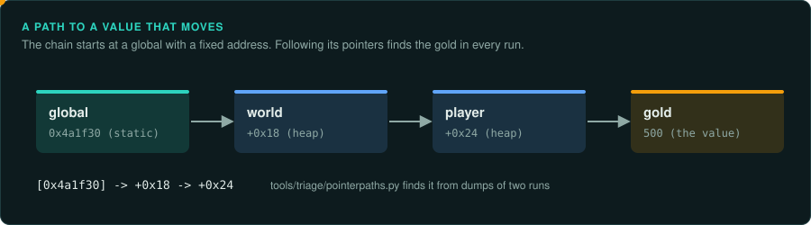

# Finding values in memory

A quick way into a game's rules is to find where it keeps a number you can see on screen, such as the gold, a unit's health, the turn or the score. Once you have the address, the code that reads and
writes it leads to the rule. Game trainers and Cheat Engine find values this way in a running
game. GameFrame does the same from memory dumps, so each step leaves a file you can keep and
repeat. The tool is `tools/triage/memscan.py`.

## Scan, change, scan again



1. Start the game in an emulator or under a debugger that can save memory. Note the value on
   screen, for example 500 gold.
2. Save a dump of the memory that could hold it. For a DOS game this is the data segment, or
   the whole of conventional memory. For a protected-mode or Windows game, it is the program's
   data and heap.
3. Change the value in the game. Spend some gold, then save a second dump. Repeat with a new
   value each time.
4. Ask which offsets fit every step.

```bash
python3 tools/triage/memscan.py derived/mem/d0.bin:=500 derived/mem/d1.bin:=480 \
    derived/mem/d2.bin:same derived/mem/d3.bin:up --base 0x1A2B0
```

The rules are `=N` for a known value, `changed`, `same`, `up` and `down` for a value you can
only compare, and `any` for no rule. Use the relative rules when the screen shows a bar
instead of a number. Two to four dumps usually leave one candidate, or a few.

| When nothing is found | Try |
|---|---|
| The value may be another size | `--type u8`, `u32`, `i16` |
| The game stores a float | `--type f32` (or `f64`) with `=N` |
| The machine is big-endian (Amiga, Mac, consoles) | `--type u16be` |
| The screen shows a scaled value | The stored value may be ten or a hundred times larger, or one less |
| The game keeps the value in two places | Both are found. The one the rules code writes is the real one, and the other is a copy for the display |
| A dump moved between saves | Dump the same region each time, from the same base |

Some games hide important values. They store the value XORed with a key, or with a second copy
to check it against. A value found nowhere, though the rules are right, may be stored that
way. Scan with `changed` and `same` instead of `=N`.

## From the address to the code



An address is a lead. Confirm it, then find the code.

- **Watch it.** Set a memory breakpoint on the address and play until the value changes. In
  DOSBox-X, the debugger command is `BPM`. `tools/dos/dbx_control.py` drives it from a
  script. The instruction that stops is the code that writes the value.
- **Search the export.** A global variable appears in the Ghidra export as a `DAT_` address.
  `tools/triage/decomp_query.py find DAT_0041a2b0` lists the functions that use it.
- **Write it.** Change the value in memory and see the change on screen. This proves the
  address holds the value the game uses.

## From one value to its structure

A value on the heap usually sits inside a structure, such as a unit, a building or a player. Its
neighbours are the other fields of the same record.

- Look at the bytes around the address in two dumps. The fields that change together belong to
  the same record.
- Find what points to the record. `memscan.py DUMP --pointers ADDR` lists every place that holds
  an address. Try the value's own address, and addresses a little below it, which may be the
  start of the record. A pointer from a global variable or a list leads to all the records of
  that kind.
- Find a second record of the same kind, such as a second unit. Its fields at the same offsets
  confirm the layout. The difference between two records' addresses may be the record's size.

Write each field into the findings with its offset, its type and the evidence. Then the
object model ([A model to query](object-model.md)) can read the original's state from a dump.

## A path to a value that moves



An object on the heap sits at a different address in every run. `tools/triage/pointerpaths.py`
finds a chain of pointers from a fixed address, such as a global variable, to the value. It
takes a dump and the value's address from each of two or more runs, and keeps the chains that
lead to the value in all of them:

```bash
python3 tools/triage/pointerpaths.py derived/mem/run1.bin@0x400000:0x1a2b3c4 \
    derived/mem/run2.bin@0x400000:0x1b0c0e8 --static 0x400000-0x4fffff
# [0x4a1f30] -> +0x18 -> +0x24
```

Read the result as "the pointer stored at `0x4a1f30`, plus `0x18`, holds a pointer; that
pointer plus `0x24` is the value". The first pointer is usually a global such as the world or
the player list. Each offset is a field of a structure. A test or an object model can follow
the chain in any run ([A model to query](object-model.md)).

## From the file to memory

A value that comes from a data file or a save can be followed from the file into memory with a
marker. `tools/formats/markers.py` writes unique values into a copy of the file, one per field.
After the game loads the copy, a dump shows where each marker went:

```bash
python3 tools/formats/markers.py plant saves/slot1.sav derived/slot1-marked.sav --from 0x40 --to 0x200
# load derived/slot1-marked.sav in the game, then dump its memory
python3 tools/formats/markers.py find derived/slot1-marked.sav.markers derived/mem/after-load.bin@0x400000
```

Each line pairs a file offset with the memory addresses where its marker appears. That maps
the file's fields onto the game's structures. A memory breakpoint on one of those addresses
finds the code that uses the field. Plant markers in a few fields at a time. A marker in a
count, an offset or a checksum can make the game reject the file or crash.

## Getting dumps

| Where the game runs | How to dump |
|---|---|
| DOSBox-X | The debugger's `MEMDUMPBIN seg:off length`. `dbx_control.py` calls it from a script |
| GameFrame's emulators | Read the memory of a `tools/emu` session after the code has run |
| Console and computer emulators | Save states hold the memory. Each emulator documents its format. Many debuggers also save a memory range |
| Windows | A debugger such as x64dbg or WinDbg can save a range. Or use Windows Task Manager's "Create dump file" for the whole process |

Dumps hold game material. Keep them in `derived/`. Record with each dump the moment it
was taken and the value on screen.
