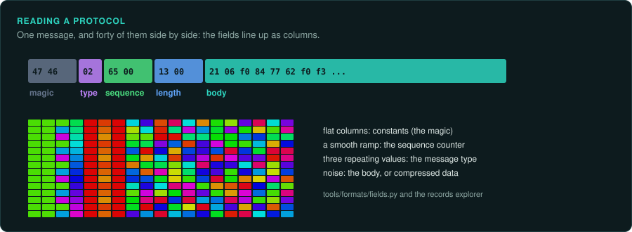

# Network games

A multiplayer game is two programs. One is the client the player runs. The other is a server, which is often gone. When the company turns its servers off, the game's online part stops. The protocol
between the two programs is all that remains to rebuild a server. This page covers recording
a protocol, reading its messages, and checking a rebuilt server or client against the
original. [Online and network games](../games/online.md) covers the rules such games share.

## Recording the traffic

- **A local server.** Many games of the era shipped a dedicated server or let one player host.
  Run both on one machine and capture the loopback interface. Nothing leaves the computer.
- **A live service that still runs.** Capture your own client's traffic. Read the service's
  terms first. Some forbid analysing their protocol.
- **A service that has closed.** Captures taken while it ran, by you or by a community, are
  the evidence. Ask where they came from and keep that with them.

- **A proxy between client and server.** A small program listens where the client connects,
  connects to the server itself, and passes every message on. It can decompress or decrypt
  each message on the way, so the log shows plain data. On a local server, it can also change
  one field of a message to see how the server reacts. That finds the server's own rules
  without its code.

Wireshark and tcpdump write `.pcap` and `.pcapng` files. Record each capture with what you did
in the game, second by second, so a message can be matched to an action.

## Reading the messages



```bash
python3 tools/formats/pcap.py derived/net/lobby.pcapng                       # the flows
python3 tools/formats/pcap.py derived/net/lobby.pcapng --flow 0 --dir b --dump derived/net/msgs
python3 tools/formats/fields.py derived/net/msgs --png derived/net/msgs.png  # what each offset holds
python3 tools/formats/fields.py derived/net/msgs --by-type 2                 # each type's own layout
```

`pcap.py` lists the conversations and writes each message as a file. `fields.py` lines the
messages up and reports, for each offset, a constant, a counter, a length or a small set of
values. The [records explorer](https://tanepiper.github.io/game-frame/lab/records) shows the
same in the browser, with the messages as rows of colour.

- **Find the framing first.** A UDP datagram is one message. A TCP stream needs a length field
  or a terminator to split it. Join a TCP direction with `pcap.py --stream`, then look for a
  length near the start of each message.
- **Then the type.** One byte near the start often selects the message type. Each type then
  has its own layout. Group by it (`--by-type`).
- **Then the counters and the checksums.** Sequence numbers rise by a fixed step. A checksum
  changes completely when any other byte changes. Find the function that computes it
  (`tools/triage/constants.py` names CRC tables).
- **Compressed or encrypted messages** look like noise in every column. Many games compressed
  with zlib, so try zlib on the message bytes first. Otherwise, find the code that sends. Break on the
  socket calls (`send`, `sendto`, `WSASend`) and read the buffer before it is encoded.
- **Match messages to actions.** The capture's timestamps and your notes say which action sent
  which message. Coverage diffing finds the code that builds it ([Debugging the original](debuggers.md#code-coverage-what-runs-when)).

## Checking a rebuilt server or client

- Replay the client's messages from a capture to the rebuilt server, and compare its replies
  with the original server's replies in the same capture.
- Run the original client against the rebuilt server, and capture again. The new capture
  should match the old one, apart from values that change by design: times, session ids,
  random seeds.
- Record every field whose meaning is guessed, and which captures show it.

## Care with online services

Run rebuilt servers for games whose official service has closed, or for your own local play.
Do not connect modified clients to services that still run, and do not get around a
service's checks. Many services forbid it, and some countries' laws do too ([Legal](../LEGAL.md)).
