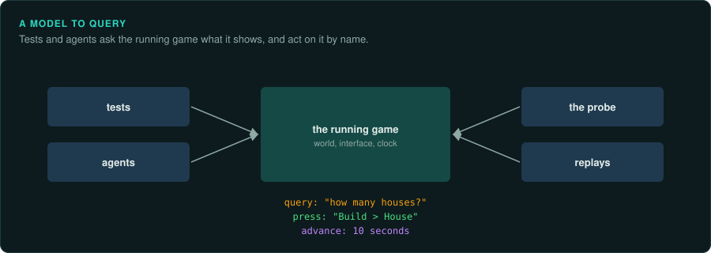

# A model to query: the game's object model and its entry points

A web page has a document object model: a tree you can query ("the button called Save"),
read ("its text") and act on ("click it"), from scripts, tests and tools. A game has no such
model. Build one for the port, so tests, scripts and agents can query and drive it. If you
build it for the original as well, you can ask both programs the same question and compare
the answers.

## What the model holds

| Part | Examples | In the original | In the port |
|---|---|---|---|
| **The interface tree** | screens, windows, buttons, lists, text, with names and rectangles | layout resources (for data-driven interfaces), or a list of screens and hotspots you write from the inventory ([Capturing the interface](ui.md)) | the port's own interface tree, with the original's names |
| **The world** | entities, units, people, buildings, items, tiles, with their fields | named variables and structures in memory, from labels or debug symbols, read from a dump or a save | the port's state, with the same names and units |
| **The session** | the current screen or loop, pause, speed, the frame or step, the seed | variables in the main loop and the loop object | the same fields |

Use the **original's names** for everything: the names from its debug symbols, exports,
resources and string tables, or your labels where it has none. Then one query finds the same
thing in both programs.

## The entry points

An entry point is a narrow, documented way into the running game. Every tool, test and recording goes
through an entry point. No tool reads or writes the game's internals any other way.

| Entry point | What it does | Examples from our ports |
|---|---|---|
| **Query** | Read the model: find elements, read fields, list entities | Un-Banished's probe (`ui`, `town`, `citizens`, `buildings`); Tyrian's `Globals`, every variable of the data segment by name |
| **Input** | Act as the player would: press, click, type, choose | the probe's `click`, `type`, `combo`, which go through the same path as a real mouse and keyboard |
| **Commands** | Apply a rules-level command at a step | Un-Banished's player commands, which multiplayer and recordings share |
| **Time** | Run, pause, step one frame or tick, run *n* steps | headless runs for *n* frames; frame-by-frame fragments in Tyrian's checks |
| **State in and out** | Load and save a full state, or one part of it | saves; Tyrian's `Globals::load` and `store` of a 64 KB data segment image |
| **Trace** | Report random draws, calls, events, as they happen | random-draw traces compared with `seqdiff.py` |
| **Capture** | Frames, sound, the interface tree as data | headless frame capture; OPL register logs |

The same entry points in the original are built from GameFrame's tools: memory reads in the
emulator or the debugger for **query** and **state**, scripted key presses for **input**,
breakpoints for **trace**, video memory for **capture**.

## Rules for the entry points

- **Entry points only read, or act as the player would.** A test that writes a field directly can
  put the game in a state that no player can reach. Inputs and commands go through the paths a player's input
  takes.
- **One query language for every caller.** A test, a script in the browser's console, an agent
  and a headless run all send the same queries. The answers come back as structured data (JSON).
- **Stable names.** Find things by the original's names or by their text. Then tests
  keep working when the layout or the timing changes.
- **Keep the entry points outside the rules.** The model and its entry points are an addition the original
  does not have: put them behind a build option. Check that the game plays identically without them (see the `re-port` skill, "Additions the original does not have").

## How to build it

1. **Name the original's state.** Labels from debug symbols (`tdinfo.py` for Borland), exports,
   RTTI and your own `labels/` files. Generate types for the original's records where you can,
   so the port and the tools share one definition.
2. **Read the original's state.** A reader that turns a memory dump or a save into the model.
   This gives you queries against the original before the port exists.
3. **Give the port the same model.** The port's state, exposed with the same names.
4. **Add the entry points one at a time**, as the work needs them: query first, then input, then
   time, then trace.
5. **Compare by query.** Put both programs in the same state, apply the same inputs, run the
   same queries and compare the answers. You can then name each difference, such as "citizen 12,
   field `hunger`".

## Examples

| Port | Model | Entry points |
|---|---|---|
| Un-Banished | the interface tree (from the original's dialog resources) and the town | the probe: in the browser console (`unbanished.click('text:New')`), in headless runs (`--probe`), in test scenarios; player commands; saves; frame capture |
| Tyrian 2000 | every data-segment variable, generated from the debug symbols, at its original offset | `Globals` load and store against memory images; per-frame fragments run from captured states; demo input per frame |
| Frontier: Elite II | the original's own memory, in the port's built-in 386 runtime | native routines hooked at the original's addresses and compared with the original's results as the game runs |

The [case studies](../case-studies/README.md) describe the tooling each port built.
