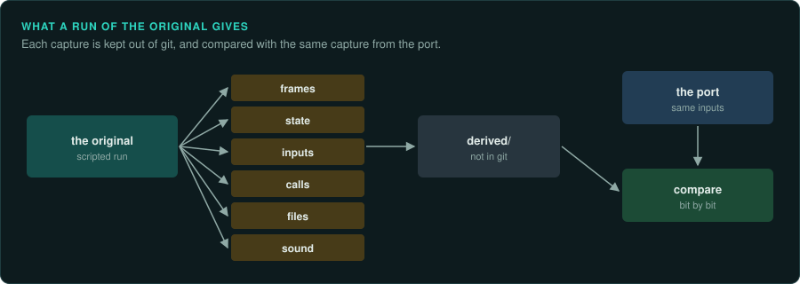
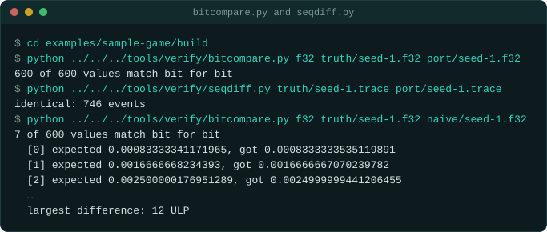

# Running the original

A run of the original shows what the code does with real inputs. Run the game wherever you can watch it, drive it, and capture what it shows, plays, reads and
keeps in memory. Most *measured* evidence (a label in GameFrame) comes from these
runs.

## Where to run it

| Environment | For | What you can capture |
|---|---|---|
| GameFrame's emulators (`pe_emu.py`, `dos_emu`, `dos_env`) | One function or the whole program, headless, scripted, in tests | Registers, memory, calls, random draws, frames from video memory, every byte ([re-emulate](../../.claude/skills/re-emulate/SKILL.md)) |
| DOSBox-X | DOS games with a window, a debugger and file logging | Breakpoints, memory dumps, file access logs, screenshots, audio and video recording ([DOS games](../DOS.md)) |
| DOSBox Staging | DOS games, accurate and simple to configure | Screenshots, audio and video, raw OPL output |
| 86Box, PCem | DOS and Windows 9x games that need exact period hardware | The full machine, slowly |
| Wine, CrossOver, Proton | Windows games on macOS and Linux | Debug channels (`WINEDEBUG=+relay` shows every API call), screenshots |
| A Windows machine or virtual machine | Windows games as players run them | Debuggers (x64dbg, WinDbg), API monitors, frame capture (RenderDoc, PIX), Steam Remote Play to stream it to another machine |
| A console emulator with a debugger (Mesen, bsnes, Dolphin, PCSX2, MAME) | Console and arcade games | Breakpoints, memory, input movies, frame advance |
| Your own runtime (as Frontier's port did) | An original that runs on the port's own CPU and DOS model | Everything, inside `cargo test`, natively and in the browser |

Prefer headless and scripted runs for evidence: they repeat exactly and run in tests. Use the
windowed runs to see what happens and to find where to look.

## What to capture

| Capture | Why | How |
|---|---|---|
| **Frames** | Ground truth for drawing and for the interface | Video memory from the emulator; screenshots; `screencapture` of a stream window; frame capture tools for 3D APIs |
| **State** | Ground truth for the rules | Memory dumps at chosen points (the data segment, the heap, named variables); the game's own saves |
| **Inputs** | To replay the same run in the port | The game's demo files; breakpoints on input reads ([Inputs](inputs.md)) |
| **Calls** | The order of functions and random draws | `call_trace.py`; debugger traces; API logs (`WINEDEBUG=+relay`, API Monitor) |
| **Files** | File formats measured from the original's own reads | DOSBox-X file logs and GameFrame's `fileio_trace.py`; Process Monitor on Windows |
| **Sound** | Music and effects compared sample by sample | The emulated chip's register writes (OPL), WAV recordings from the emulator |
| **Timing** | Tick rates, music tempo | Timer programming, frame counts, audio recordings measured over a long run |

Keep every capture in the project's ignored folders (`derived/`, `game-data/`): captures are
game material ([Legal](../LEGAL.md)).

## Driving the original

Drive the original by script, so you can make each capture again:

- In GameFrame's emulators, script the inputs: `dos_env` answers the BIOS and DOS key
  reads from a queue (`env.keys`). You can also write a game's own key table in memory between frames.
- In DOSBox-X, script the debugger over its control channel (Tyrian's `dbx_control.py`) or
  type into the window with an automation tool.
- On a Windows machine streamed to your desk, an agent with computer-use access can watch and
  press buttons. The video is compressed: compare by layout and with blurred image
  differences, not pixel by pixel.
- Use the game's own demo and replay files whenever they exist.

Write down, next to each capture, the inputs that made it: the version of the game, the
settings, the seed, the commands or the demo, and the frame.

## Comparing

| What | How | Tool |
|---|---|---|
| Numbers and state | bit for bit, with the first difference reported | `tools/verify/bitcompare.py`; tests that load a captured state and run the port |
| Sequences (draws, calls, events) | the first point where they differ | `tools/verify/seqdiff.py` |
| Frames | pixel for pixel when both are exact; image difference with blur and a threshold when one is a compressed stream | an image-difference tool (Un-Banished's `imgdiff`) |
| Sound | sample for sample when both come from the same chip model; by ear and spectrum otherwise | the OPL register log; a WAV difference |

On the sample game, the port matches the emulated original bit for bit. Its random draws come in the same order. A port that computes in double precision instead of float is off by a few ULP. `bitcompare.py` reports each difference.

## Further reading

- [Capturing the interface](ui.md): an inventory of every screen.
- [Inputs](inputs.md): what to record.
- [A model to query](object-model.md): reading the original's state the same way as the port's.
- The `re-verify` skill: how the checks fit together.
