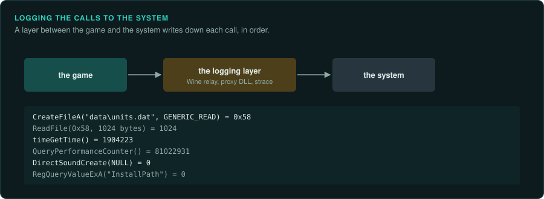

# Tracing calls to the system

A game asks the system for everything it gets from outside: files, the clock, input, sound,
graphics, the registry, the network. A log of those calls, in order, shows what the game does
without reading its code. It shows which files it opens at start-up, how often it reads the
clock, which sound device it uses and which settings it reads. The log is measured evidence,
and it points to the code worth reading. This page lists the ways to record it on each system.

## What to look for



| Question | Calls to log |
|---|---|
| Which files load, in what order, and which bytes of each | Opening, reading, seeking and closing files |
| Where the settings and saves live | Registry reads and writes; files in the user's folders |
| How the game keeps time | Clock reads (`timeGetTime`, `QueryPerformanceCounter`, `GetTickCount`, `clock_gettime`), sleeps, timers |
| How it plays sound and music | The sound library (DirectSound, waveOut, MCI for CD audio, OpenAL, SDL) and its buffer sizes |
| What it draws with | The graphics library and the display mode it sets |
| Whether it loads code at run time | Library loads and lookups of functions by name (`LoadLibrary`, `GetProcAddress`, `dlopen`, `dlsym`). These calls are not in the import table |
| Where it reads input | Keyboard, mouse and joystick calls ([Inputs](inputs.md)) |

## Windows games under Wine

Wine prints its own debug channels when `WINEDEBUG` is set. This works on Linux and macOS and
needs no change to the game.

```bash
WINEDEBUG=+relay,+timestamp,+tid wine game.exe 2> derived/relay.log     # every call between DLLs
WINEDEBUG=+file,+reg wine game.exe 2> derived/files.log                 # files and registry only
WINEDEBUG=+loaddll wine game.exe 2> derived/dlls.log                    # which DLLs load, when
```

The relay log is very large, because it holds every call between modules with its arguments
and its return value. Limit it to the libraries that matter with the `RelayInclude` and
`RelayExclude` values in the registry key `HKCU\Software\Wine\Debug`. Each value takes a list of
names, such as `kernel32.CreateFileA;kernel32.ReadFile`. Other useful channels are `+dsound`,
`+winmm` (which includes MCI, for CD audio), `+d3d`, `+ddraw`, `+dinput` and `+seh` (exceptions).

## On Windows

- **Process Monitor** (Sysinternals) records file, registry, process and network activity for
  a chosen process, with the call stack of each event. Filter on the game's process name, then
  save the log as CSV.
- **API Monitor** (rohitab.com) logs calls to chosen functions with their arguments and return
  values, grouped by library.
- **A proxy DLL.** A DLL placed in the game's folder with the name of a system DLL the game
  loads (for example `dsound.dll` or `winmm.dll`) is loaded instead of the system one. It can
  log each call and then pass it on to the real DLL. Wrappers such as DxWnd and dgVoodoo work
  this way. Use a proxy only on a copy of the game, and record it with the evidence.

## Hooking a function inside the game

The game's own functions can be logged the same way: replace the first instructions of a
function with a jump to your code, log the arguments, then run the original. Frida does this
for Windows, Linux and macOS programs from a short script, with no change to the files on disk.
Detours libraries do it from a DLL loaded into the game. Use it to log every call to the
random generator with its result, every sound the game plays, or every state change of an
object you are tracing. Use hooks only on your own copy, in single-player games, for
observation. Online games forbid them, and their anti-cheat systems detect them.

## Native Linux and macOS games

- `strace -f -tt -e trace=file,read,write,ioctl ./game` records system calls with times
  (`-e trace=` narrows the list).
- `ltrace -f -e 'fopen+fread+rand+srand' ./game` records calls into shared libraries, where it
  works with the binary.
- `LD_PRELOAD` (Linux) and `DYLD_INSERT_LIBRARIES` (macOS) load a small library of your own
  before the game's libraries. A function in it with the same name as a library function
  replaces it, logs the call and calls the original. It can log every `rand()` call with its
  caller, or fix the seed so that two runs match. macOS ignores `DYLD_INSERT_LIBRARIES` for
  programs with the hardened runtime or with System Integrity Protection. Work on a copy
  without the signature, or run the game under a debugger instead.

## DOS games

A DOS game calls DOS through interrupt `21h` and the BIOS through other interrupts. DOSBox-X
logs file access, and `tools/dos/fileio_trace.py` turns that log into a map of reads per file.
The DOSBox-X debugger can stop on an interrupt with a chosen function (`BPINT 21 3D` stops on
every file open). [DOS games](../DOS.md) lists the commands. GameFrame's own DOS environment
(`tools/emu/dos_env`) keeps a log of what the program asked of DOS, in order (`env.log`).

## Consoles

A console game talks to the hardware, so there are no system calls to log. Emulators log the
same events in their own way: reads from the disc, DMA transfers, writes to the sound and
video chips. Each emulator documents its logging options. The page for each console lists the
emulators with debuggers ([Console games](../consoles/README.md)).

## What to record

- The command and the settings used, with the log, so the run can be repeated.
- The order of files at start-up, and the offsets and sizes of the reads in each.
- Every library loaded at run time, and every function looked up by name.
- The clock calls and their rate, which say how the game keeps time.
