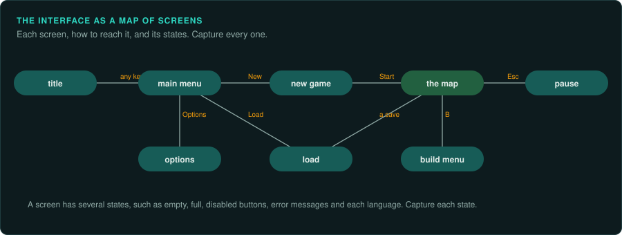

# Capturing the interface

A game's interface is usually written for that game alone. Players also notice it first.
This page explains why it is hard, how to make an inventory of it, and how to capture enough of
the running original to rebuild it.

## Ask your agent

Inventory the interface. Copy this prompt into your coding agent:

```text
In my GameFrame project, make an inventory of every screen.

1. Read docs/observe/ui.md.
2. Find screens three ways: from the main menu's code, from the layout and string data, and by
   playing the game (ask me to play, or drive it by script).
3. For each screen, record how to reach it, the code or layout that draws it, its states, its
   inputs, what it changes, its text and its font.
4. Capture each state with the inputs that reached it, into derived/.
```

## Why game interfaces are custom

Most software builds its interface from a toolkit: the operating system's buttons, lists and
dialogs. Games rarely do. They draw everything themselves, because they control the whole
screen, want their own look, and in older games had no toolkit that was fast enough.

The games people reverse engineer are mostly from before off-the-shelf engines were common.
In the DOS and early Windows years, almost every game had its own engine: its own drawing
code, fonts, menus, and input handling. Licensed engines (id Software's, Build, Unreal) came
in the mid-1990s and mostly for first-person games; Unity and Unreal became the default for
most studios only in the 2010s. Expect these in most games you work on:

- **Each screen is drawn by code.** Menus, HUDs, shops, inventories and dialogs are drawn by the
  game's own functions, often straight to video memory, with the game's own font.
- **Little is shared between screens.** Two menus may be built by two different routines with
  different input handling and timing.
- **The interface code contains rules.** What can be bought, dropped or built, and in what order
  screens appear, are often decided inside the interface code.
- **Later games use data.** Some games (Banished, Infinity Engine games, many 2000s games)
  read layouts, text and events from data files: a widget tree with names and handlers. Then
  the layout comes from data, and only the behaviour behind each control is code.

Even a game built on an engine usually has a custom interface on top of it.

## Make an inventory



Before porting any screen, list them all. For each screen, write down:

| Field | Example |
|---|---|
| Name and how to reach it | "Ship upgrade shop: from the level-end menu, item 3" |
| The code that draws and runs it | the function's address, or the layout resource's name |
| Its states | normal, item selected, not enough money, confirming |
| Its inputs | keys and clicks it reads, and where it reads them |
| What it changes | the variables and commands it produces |
| Text and fonts | the string table entries, the font resource |
| Captures | the screenshots and state dumps of each state |

Find screens three ways: play the game and capture every screen you reach; follow the code
from the main menu's loop to every screen it calls; and list the data (layout files, string
tables, fonts, cursor images). Each finds screens the other two miss (debug menus, error
messages, end screens).

## Capture as much as you can

Run the original where you can capture its frames ([Running the original](running-the-original.md)),
and for each screen and state in the inventory:

1. **A screenshot** at the game's own resolution, lossless where possible.
2. **The state that produced it**: the variables the screen reads (from a memory dump or a
   save), so the port can be put in the same state.
3. **The input that reached it**: the keys or clicks, so the capture can be made again.
4. **Timing**: how many frames a fade, a scroll or a blinking cursor takes, from a frame-by-frame
   capture.

Script the captures, so you can repeat them after a game update or for another language.

For a game that draws its own interface, a capture must hold:

- **Every surface the screen is drawn on.** The HUD and messages are often drawn straight
  to the display, not into the off-screen frame the game builds the picture in. Save both.
- **Text as pixels.** The game's own font tables, often with shadow or darkened variants:
  check text pixel by pixel, like sprites.
- **What was on screen before.** Status bars often redraw an item only when its value
  changes, comparing with a "last value" variable. A test that starts in the middle of a
  run needs the display contents from before, and those variables.
- **Off-screen buffers.** Tile maps and effect buffers the frame draws from or into live in
  memory blocks the program allocated. Save each block with the pointer or selector that
  names it; for the state after the frame, keep only the blocks that changed.

## Rebuild it

- **Data-driven interfaces:** write a reader for the layout format, and an engine that builds
  the same tree with the same names. Tests and tools then find controls by those
  names ([A model to query](object-model.md)).
- **Interfaces in code:** port each screen's drawing and input functions like any other game
  logic, with the font and shapes read from the game's data.
- **Either way:** the interface reads the game's state and produces commands. Keep it out of the rules. Then a test can drive the rules without the interface. The interface can be checked against captures on its own.

## Check it

- Put the port in the captured state, draw the screen, and compare with the screenshot: pixel
  for pixel when both are exact, with an image difference and a threshold when the capture
  comes from a compressed stream.
- Press the same inputs and compare the commands the screen produces.
- Check text in every language the game ships: line breaks and widths change with the text.

Each project decides how exact the interface must be ([Who drives](../games/interaction.md#the-four-kinds)).
A 1:1 project must match every pixel of every frame of it.
