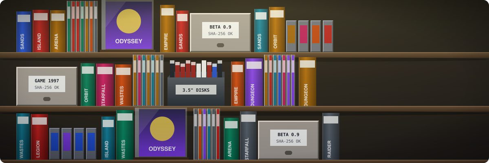

# Game preservation

Many older games can no longer be bought. Many games people own no longer run on current
computers. Some games are still on sale, but nobody has updated them in years. GameFrame
helps the owner of such a game keep it playable. It works from the copy the owner bought. It rebuilds the game in new code that behaves exactly like the original. Along the way, it writes down how the game works.

GameFrame does not share games. It ships no game files, assets or decompiled code. It is
tested only on sample programs written for it.

The chapters are:

1. [Why games disappear](why-games-disappear.md): games that are out of print, games that no
   longer run, games their makers stopped updating, and games whose source code is lost.
2. [What GameFrame does](what-gameframe-does.md): the documents and code a project makes, how
   they are checked against the original, and what GameFrame cannot do.
3. [Your own copy and the law](law/README.md): the law in 35 countries, with one page per
   region. It explains why "abandonware" has no legal standing. It also lists past
   takedowns of game projects.
4. [AI and reverse engineering](ai.md): the concern about AI copying games, and what
   GameFrame does about it.
5. [Built on others' work](others-work.md): the projects and institutions GameFrame learns
   from, and where to read more.
6. [For developers and publishers](rights-holders.md): what we promise the people who made
   these games, and how to reach us.

This section is not legal advice. For the working rules of a project, read
[Legal](../LEGAL.md).
