# AI and reverse engineering

GameFrame is written for AI agents working with people. Many people who reverse engineer
games by hand are worried about AI. This chapter describes that worry and what GameFrame
does about it.

## The concern

On 15 October 2026, 404 Media reported that decomp.dev was shutting down. decomp.dev was a
website for the community that decompiles games by hand. Its administrator wrote that AI had
broken "the community aspect of decompilation"
([404 Media](https://www.404media.co/video-game-reverse-engineering-community-shuts-down-because-ai-has-made-it-too-easy/)).
People using AI now produce projects faster than people working by hand. It has become hard to
tell which projects a person led.

AI tools also make it easy to produce a cheap imitation of a game. An imitation can copy how a game looks
without behaving like it. It can also be a way to copy a game that is still on sale.

We share these concerns. An AI agent can read old code quickly. A port made quickly can still behave differently from
the original.

## What GameFrame does about it

GameFrame asks an agent for evidence at every step.

- **The original is required.** Every project starts from the owner's own copy. The agent reads
  that program. It has no other source.
- **Results are measured.** The agent runs functions of the original under emulation to get
  exact answers ([re-emulate](../../.claude/skills/re-emulate/SKILL.md)).
- **The port must match.** The new code must give the same answers to the last bit. A port that
  does not match fails its tests ([re-verify](../../.claude/skills/re-verify/SKILL.md)).
- **Every claim is cited.** Each finding names the place in the original it came from, and says
  whether it was read, measured or guessed ([Writing findings](../working/writing.md)).
- **A person reviews the work.** The agent lands each piece of work as a small commit that a
  person reads ([re-land](../../.claude/skills/re-land/SKILL.md)).
- **Nothing from the game is shared.** Decompiled code stays on the owner's computer. The
  published code is new ([Legal](../LEGAL.md)).

This takes longer than making an imitation. Anyone with the same copy of the game can run the
same tests and get the same answers.

## Earlier work

The methods in GameFrame come from people who did this work by hand for decades: the
ScummVM developers, the decompilation communities, the authors of OpenRCT2, OpenTTD,
DevilutionX and many more ([Built on others' work](others-work.md)). The playbook tells agents to
read their documents.
