# Built on others' work

GameFrame learns from projects that kept games playable long before it existed. Each project
below needs the player's own copy of the game and links to a store that sells it.

## Projects

| Project | Game | What it does |
|---|---|---|
| [ScummVM](https://www.scummvm.org/) | over 325 adventure games | Rewrites the games' engines in new code. It began in 2001 and celebrated 25 years in 2026 |
| [OpenRCT2](https://github.com/OpenRCT2/OpenRCT2) | RollerCoaster Tycoon 2 | Replaced the original program one function at a time while the game kept running |
| [OpenTTD](https://www.openttd.org/) | Transport Tycoon Deluxe | Began from a disassembly. It has since added many features the original lacked. Since March 2026, the Steam and GOG versions need a bought copy of the original game |
| [DevilutionX](https://github.com/diasurgical/devilutionX) | Diablo | Runs the player's own Diablo data on current systems. GOG lists it as a free add-on for its copy of Diablo |
| [The Force Engine](https://github.com/luciusDXL/TheForceEngine) | Dark Forces, Outlaws | Rebuilds LucasArts' Jedi engine from reverse engineering |
| [dethrace](https://github.com/dethrace-labs/dethrace) | Carmageddon | Replaces the original's code one function at a time. Each new function is checked against the original |
| [MAME](https://github.com/mamedev/mame) | thousands of arcade machines | Its code documents each machine. Playing the games tests that documentation |

The [taxonomy of games](../games/README.md) lists many more for each kind of game.

## Rights holders who helped

- Electronic Arts released the source code of Command & Conquer and Red Alert in 2020, and of
  more Command & Conquer games in February 2025. Players still buy the game data.
- GOG started its Preservation Program in late 2024. It keeps about 100 classic games working on current systems. It has added more since
  ([GOG](https://www.gog.com/en/gog-preservation-program)).
- Atari re-released Transport Tycoon Deluxe in March 2026 and contributes to OpenTTD's server
  costs ([OpenTTD](https://www.openttd.org/news/2026/03/19/steam-changes-update)).

## Further reading

- [Video Game History Foundation](https://gamehistory.org/), including its
  [digital library](https://library.gamehistory.org/) of magazines and documents.
- [The Strong National Museum of Play](https://www.museumofplay.org/), which holds hardware,
  documents and source code.
- [Software Heritage](https://www.softwareheritage.org/), an archive of source code.
- [Digital Preservation Coalition](https://www.dpconline.org/).
