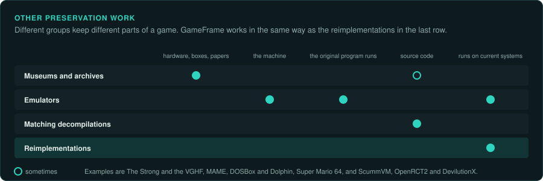
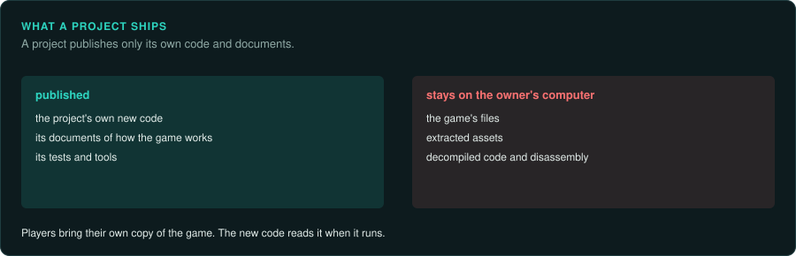

# What GameFrame does

GameFrame helps one person study a game they own and rebuild it in new code. The new code
runs on current computers. It reads the owner's original game files when it runs. It must give
the same results as the original, measured on the original's own code.

## Documents of how the game works

MAME, the arcade emulator, describes its own source code as documentation of the machines it
emulates. The MAME team says that playing a game mainly shows that the documentation is right
([MAME](https://github.com/mamedev/mame)). GameFrame applies this idea to a single game.

- The findings are written down as documents, with the address in the original that each claim
  comes from ([Writing findings](../working/writing.md)).
- Functions of the original run under emulation to give exact answers for chosen inputs
  ([re-emulate](../../.claude/skills/re-emulate/SKILL.md)).
- The new code must give the same answers to the last bit. A port that does not match fails its
  tests ([re-verify](../../.claude/skills/re-verify/SKILL.md)).
- File formats are decoded and proved against every file of their type
  ([re-format](../../.claude/skills/re-format/SKILL.md)).

A later project can use the documents without the port's code.

## Other preservation work

Different groups preserve different parts of a game.

| Who | What they keep |
|---|---|
| Museums and archives (The Strong, the Video Game History Foundation) | Hardware, discs, boxes, magazines, design documents, sometimes source code |
| Emulators (MAME, DOSBox, Dolphin) | The machine, so the original program runs unchanged |
| Matching decompilations (Super Mario 64, Ocarina of Time) | Source code that compiles to the identical original program |
| Reimplementations (ScummVM, OpenRCT2, DevilutionX) | New code that runs the original game's data on current systems |

GameFrame belongs to the last group. Its playbook gives an agent the method as skills to
follow step by step. Its toolkit checks the new code against the original's own code, one
function at a time.

## What it cannot do

- It cannot help anyone who does not own the game. Every project starts from a bought copy.
- It cannot bring back a game whose files are gone, or an online game whose server code was
  never released.
- It does not make a game available to people who cannot buy it. Most of the 87% of games out
  of print stay out of print.
- A careful reimplementation of a small game takes weeks of work by a person and an agent
  together.

## What a project ships

A project made with GameFrame may publish its own new code and its documents. It never
publishes the game's files, extracted assets or decompiled code. Players bring their own copy
of the game ([What a project can ship](../OUTPUTS.md)).
