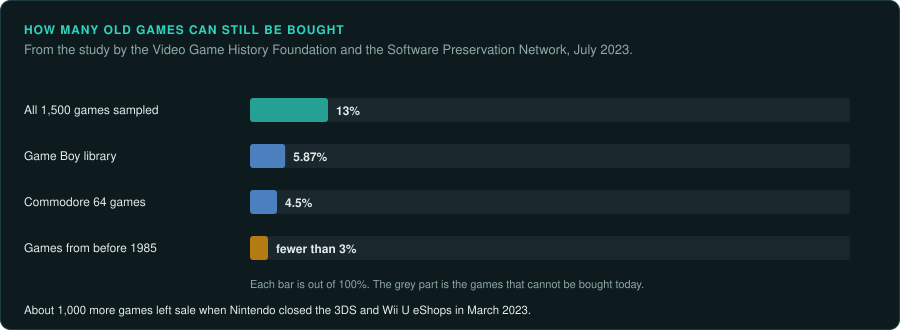
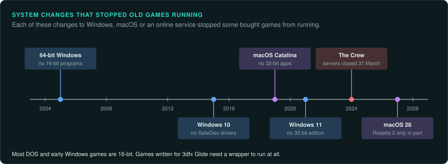
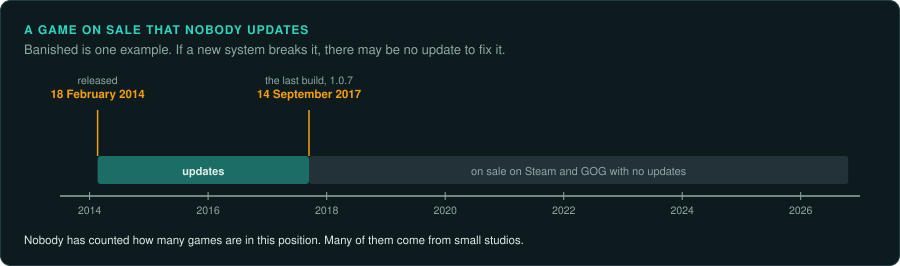
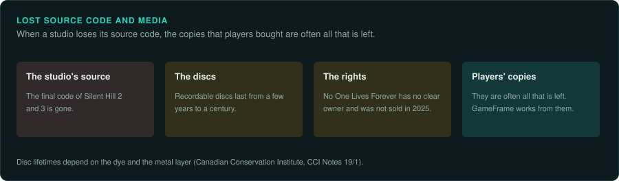

# Why games disappear

A game can be lost in several ways. Its maker can stop selling it. A new computer can stop
running it. Its maker can stop updating it while it is still on sale. Its source code and its
discs can decay or go missing.

## Games that are out of print

In July 2023 the Video Game History Foundation and the Software Preservation Network published
a study of the US reissue market. It sampled 1,500 games released in the US before 2010. Only
13% of them can be bought today
([VGHF study explainer](https://gamehistory.org/study-explainer/)). In every five-year period of the
sample, fewer than 20% of the games are in print.

The share is lower for some platforms. The study found 4.5% of Commodore 64 games in print. Almost all of those come from one service, Antstream. It found 5.87% of the Game Boy library in print.
Fewer than 3% of games from before 1985 are in print. About 1,000 games left sale when Nintendo
closed the 3DS and Wii U eShops in March 2023.

The 13% figure counts the games you can legally buy and play today. Many of the others still
exist on original discs and cartridges that nobody sells today.

## Games that stop running

A game bought years ago can stop running on a new computer or a new operating system.

- **64-bit Windows does not run 16-bit programs**
  ([Microsoft KB 896458](https://support.microsoft.com/kb/896458)). Windows 11 has no 32-bit
  edition, so no Windows 11 computer runs 16-bit programs. Most DOS games and early Windows
  games are 16-bit.
- **Windows 10 dropped the drivers for SafeDisc and older SecuROM** copy protection. Many games
  from about 2003 to 2008 depend on them and no longer start
  ([PC Gamer](https://www.pcgamer.com/report-games-with-securom-and-safedisc-drm-wont-run-under-windows-10/)).
- **macOS Catalina (2019) removed support for 32-bit apps**
  ([MacRumors](https://www.macrumors.com/guide/32-bit-mac-apps/)).
- **Apple is retiring Rosetta 2**, which runs Intel programs on Apple silicon. Apple's plan keeps
  it for general use through macOS 27. From macOS 28 it keeps only a part of it, aimed at older
  games that their makers no longer maintain
  ([MacRumors](https://www.macrumors.com/2026/02/16/macos-tahoe-26-4-rosetta-2-warnings/)).
- **Games written for 3dfx Glide**, a 3D card interface of the late 1990s, need a third-party
  wrapper to run at all ([3D accelerators](../hardware/graphics-3d.md)).

A game that needs an online service stops working when the service closes. Ubisoft closed the servers of The Crew on
31 March 2024 and removed the game from players' libraries.

## Games on sale that nobody updates

Some games are still sold, but their makers have stopped working on them. Banished is one
example. Shining Rock Software, a studio of one person, released it on 18 February 2014
([Wikipedia](https://en.wikipedia.org/wiki/Banished_(video_game))). Its last build, 1.0.7, is
dated 14 September 2017 in GOG's build history
([GOGDB](https://www.gogdb.org/product/1207660783)). The game is still on sale on Steam and GOG.
If a later version of Windows or macOS breaks the game, there may be no update to fix it.

Nobody has counted how many games are in this position. Many games from small studios are in it.
[Un-Banished](../case-studies/banished.md) is GameFrame's case study of one.

## Lost source code and media

Studios lose their own code. Konami no longer had the final code of Silent Hill 2 and 3. Its HD
Collection was built from incomplete code
([Push Square](https://www.pushsquare.com/news/2012/05/silent_hill_hd_collection_ported_from_incomplete_code)).
Square Enix said data from the first Kingdom Hearts was lost. Its HD version recreated it
([Game Revolution](https://www.gamerevolution.com/news/5796-square-lost-kingdom-hearts-assets-forced-to-recreate-hd-version-from-scratch)).

Discs decay. The Canadian Conservation Institute gives recordable discs lifetimes between a few
years and a century, depending on the dye and the metal layer
([CCI Notes 19/1](https://www.canada.ca/en/conservation-institute/services/conservation-preservation-publications/canadian-conservation-institute-notes/longevity-recordable-cds-dvds.html)).

Some games cannot be sold because nobody can say for certain who owns them. No One Lives
Forever (2000) could still not be bought legally at its 25th anniversary in 2025 for this reason.

When a studio loses its source code, the copies players bought are often all that is left.
GameFrame works from those copies.
