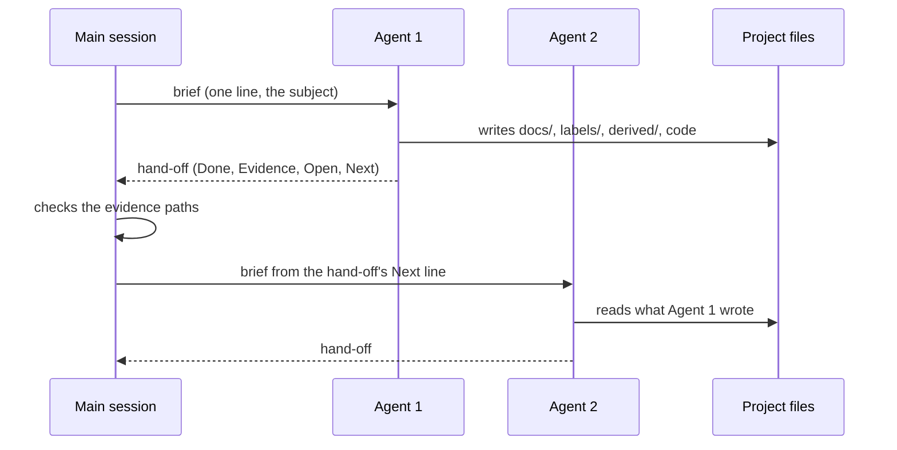

# Agent teams

GameFrame has 18 agents. Nine stage agents follow the steps of the method. Nine task agents
do one job each. A team is a set of agents that work on one piece of a game in a fixed order,
each one handing its results to the next. This section describes the teams, what each agent
receives and produces, and what a team delivers at the end.

## Ask your agent

Run a team. Copy this prompt into your coding agent:

```text
In my GameFrame project, run the <team name> team on <subject>.

1. Read docs/teams/README.md and the page for that team.
2. Send the team's agents one at a time, in the order the page shows, each with a one-line
   brief.
3. After each agent, read its hand-off. Check that the files it names exist and that its
   claims carry evidence labels. Then send the next agent it names.
4. When a check fails, follow the team's failure path.
5. At the end, report what the team delivered, with the commit and the test results.
```

## How a team works



The main session coordinates. It sends one agent at a time, reads the agent's hand-off, checks
it, and sends the next agent. Agents never call each other directly. The data moves through
files in the project, and the hand-off names them.



## The hand-off

Every agent ends its run with the same block. The main session reads it before it sends the
next agent.

```text
## Hand-off
Stage: re-tracer
Done: <what is now true, one line each>
Evidence: <files written or changed, with paths>
Open: <questions and gaps, or "none">
Next: <agent name> - <one-line brief for it>
```

| Field | What it holds | What the main session does with it |
|---|---|---|
| `Done` | Facts that are now true, one per line | Compares them with the brief |
| `Evidence` | Paths of the files the agent wrote or changed | Opens them and checks they exist |
| `Open` | Questions and gaps the agent could not close | Adds them to `docs/CHECKLIST.md`, or asks the user |
| `Next` | The next agent and a one-line brief | Sends that agent, or chooses another when the brief does not fit |

## Where the data lives

| Folder or file | Holds | Written by | Read by |
|---|---|---|---|
| `docs/FINDINGS.md` | Binaries, engine, kind of game, inputs, screens | surveyor, identifier, listener, cataloguer | every agent |
| `docs/<topic>.md` | Traced behaviour with evidence labels | tracer, decoder, measurer, randomiser | porter, verifier, checker, editor |
| `labels/names.tsv`, `labels/fields.tsv` | Names of functions and fields | identifier, mapper, tracer | decompiler (re-export), every tool |
| `analysis/` (ignored) | Ghidra project and the text export | decompiler | tracer, mapper, identifier, randomiser |
| `derived/` (ignored) | Captures, emulator results, call traces | observer, measurer, randomiser, cataloguer, matcher | porter, verifier |
| The port's code and tests | The reimplementation | porter | verifier |
| `docs/CHECKLIST.md` | What is traced, measured, ported and verified | lander | the main session |

## The agents

| Agent | Kind | Receives | Produces |
|---|---|---|---|
| `re-surveyor` | stage | The game's files | `FINDINGS.md`: binaries, kind of game, tools ready |
| `re-observer` | stage | A behaviour to capture | Capture scripts, frames, state, inputs in `derived/` |
| `re-decompiler` | stage | Binaries to export | Ghidra export in `analysis/` |
| `re-tracer` | stage | A question ("how does the game do X?") | A topic document, labels |
| `re-decoder` | stage | A data file type | A format document, a reader that consumes every byte |
| `re-measurer` | stage | Functions that must match exactly | Ground truth in `derived/` |
| `re-porter` | stage | Traced and measured behaviour | New code with tests |
| `re-verifier` | stage | New code and its ground truth | A verification report |
| `re-lander` | stage | A finished slice | Documents, labels, checklist, a commit |
| `re-identifier` | task | The game's files | Engine, libraries and compiler in `FINDINGS.md`, library labels |
| `re-randomiser` | task | The export | Generators, callers, draw order, a call trace |
| `re-listener` | task | The export | The inputs table and the proposed input record |
| `re-cataloguer` | task | The running game | The screen inventory with captures |
| `re-mapper` | task | The export and the platform's register list | Named hardware registers, banks and RAM variables |
| `re-typer` | task | The export | Structures, classes and enumerations in Ghidra and `labels/fields.tsv` |
| `re-matcher` | task | A crate, library or released source | A bit-for-bit comparison with the game's version |
| `re-editor` | task | Documents | The same documents in plain English |
| `re-checker` | task | Documents | Checked claims, doubtful ones marked |

## Teams

- [Start-up team](start-up.md): a new game, from its files to a project ready to trace.
- [Exact system team](exact-system.md): a system with arithmetic or random draws, ported bit
  for bit.
- [Data format team](data-format.md): a file format, decoded and read by the port.
- [Main loop team](main-loop.md): the frame or tick, the input record and replays.
- [Interface team](interface.md): every screen, rebuilt and compared with captures.
- [Sound and hardware team](sound-hardware.md): a sound chip or other device, driven by the
  game's own writes.
- [Documentation team](documentation.md): documents checked, edited and published.
- [Failure path](failure.md): what a team does when a check fails.
