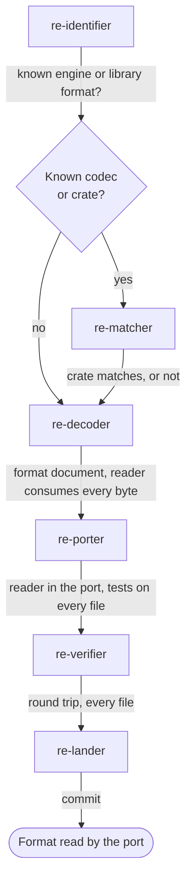

# Data format team

Use this team for a file the game reads: an archive, a level, a save, a sound or a table of
rules. It decodes the format, proves the decoder on every file, and gives the port a reader.

## Steps

| Order | Agent | Brief | Hands on |
|---|---|---|---|
| 1 | `re-identifier` | "Is &lt;file type&gt; a known engine or library format?" | The format's origin in `FINDINGS.md`, with the evidence |
| 2 | `re-matcher` (when a crate or library exists) | "Compare &lt;crate&gt; with the game's decoder" | A comparison report: matches, or the first difference |
| 3 | `re-decoder` | "Decode &lt;file type&gt;" | `docs/formats/<type>.md`; a prototype reader that consumes every byte of every file |
| 4 | `re-porter` | "Port the &lt;type&gt; reader" | A reader in the port with tests over every file |
| 5 | `re-verifier` | "Verify the &lt;type&gt; reader" | Every file decodes; files the game writes round-trip byte for byte |
| 6 | `re-lander` | "Land the &lt;type&gt; format" | A commit |

## Outcome

- A format document: the layout, field by field, with offsets and evidence.
- A reader that reads every file of the type to the last byte.
- For files the game writes (saves, settings), a writer that reproduces the original bytes.

## Choices for the main session

- When `re-decoder` finds fields it cannot explain from the files alone, send `re-tracer` to
  the code that reads them.
- Skip `re-matcher` when no ready implementation exists.
