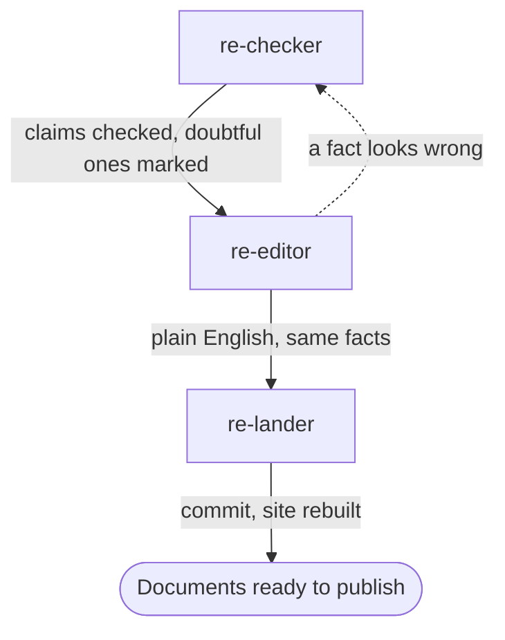

# Documentation team

Use this team before publishing documents: findings, guides, a website, release notes. It
checks every claim, rewrites the wording to the writing rules, and lands the result.

## Steps

| Order | Agent | Brief | Hands on |
|---|---|---|---|
| 1 | `re-checker` | "Check the claims in &lt;files&gt;" | Each claim's evidence and sources checked; corrections made; unconfirmed claims marked "(not confirmed)" |
| 2 | `re-editor` | "Edit &lt;files&gt; to the writing rules" | The same facts in plain English, with none of the patterns to avoid |
| 3 | `re-lander` | "Land the documents" | A commit; the website rebuilds from it |

## Outcome

- Every claim has its evidence label and a source that supports it.
- Claims that could not be confirmed stay in the text, marked as such.
- The text follows [Writing](../working/writing.md): short sentences, no rhetorical patterns,
  no statements about how the page was made.

## Choices for the main session

- Run the checker before the editor. The editor changes wording only, so it must start from
  correct facts.
- For a large set of documents, run the team once per folder.
