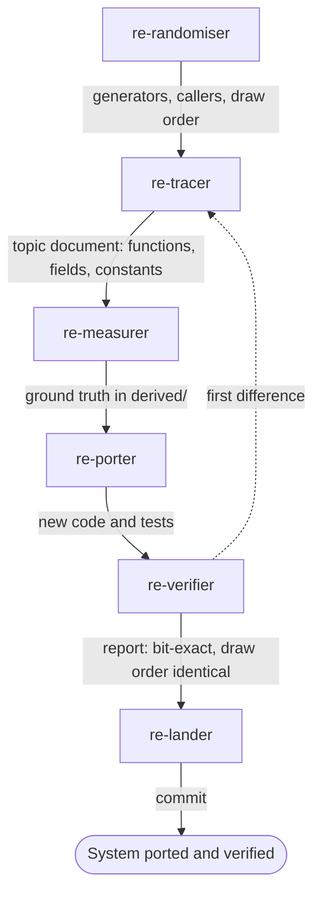

# Exact system team

Use this team for a system whose results must match the original bit for bit: the random
number generator, maths helpers, map generation, pathfinding, a simulation step. It finds the
code, measures the original, ports it and proves the port matches.

## Steps

| Order | Agent | Brief | Hands on |
|---|---|---|---|
| 1 | `re-randomiser` (when the system draws random numbers) | "Find the generators and the draws of &lt;system&gt;" | Generator state and seeding; callers in loop order; a call trace of a few frames |
| 2 | `re-tracer` | "How does the game do &lt;system&gt;?" | `docs/<system>.md`: functions, inputs, fields, constants, the loop that calls it |
| 3 | `re-measurer` | "Measure &lt;functions&gt; on many inputs" | Ground truth files in `derived/emu/`, with the inputs named |
| 4 | `re-porter` | "Port &lt;system&gt; from docs/&lt;system&gt;.md" | New code citing each original function; tests that read the ground truth |
| 5 | `re-verifier` | "Verify &lt;system&gt; against derived/emu" | Bit-for-bit results, draw order compared with `seqdiff.py` |
| 6 | `re-lander` | "Land &lt;system&gt;" | Documents, labels, checklist, a commit |

## Outcome

- A topic document with every function and constant, each with its evidence label.
- Ground truth from the original, kept out of git in `derived/`.
- Ported code with tests that skip without the ground truth and pass with it.
- A verification report: the number of inputs compared, all identical, and the same draw
  order.

## Choices for the main session

- Skip `re-randomiser` for a system that draws no random numbers.
- When the system uses a C runtime or language runtime (`sinf`, `qsort`, Turbo Pascal's
  `Real`), send `re-matcher` before `re-porter`. It checks whether a GameFrame crate already
  matches the game's version ([Crates](../crates/README.md)).
- On a difference, follow the [failure path](failure.md).
