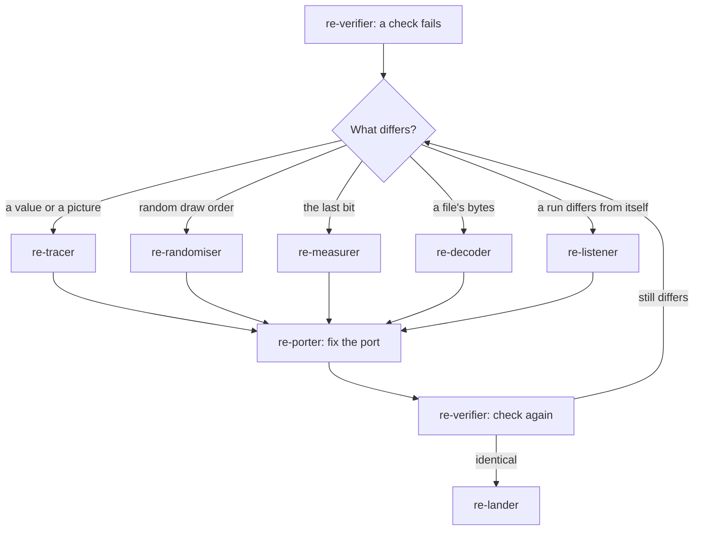

# Failure path

Every team ends with `re-verifier`. When it finds a difference, the team stops before
landing and goes back to the agent that can explain the difference, then ports and verifies again. This
page shows where a failure goes.



| What differs | Agent | What it does |
|---|---|---|
| A value or a picture | `re-tracer` | Re-reads the function at the first difference |
| The order of random draws | `re-randomiser` | Finds the extra or missing draw |
| Arithmetic in the last bit | `re-measurer` | Measures the step that differs |
| A file's bytes | `re-decoder` | Finds the field that differs |
| A run differs from itself | `re-listener` | Finds the input that is not in the record |

## What the verifier hands on

A failing hand-off names the first difference:

```text
## Hand-off
Stage: re-verifier
Done: compared 600 values; 412 identical
Evidence: derived/verify/terrain-diff.txt
Open: first difference at input 413, field height, 0.5 ULP
Next: re-measurer - measure FUN_140041a20 at input 413, step by step
```

## Rules for the main session

- Send the agent the table above points to, with the first difference in its brief.
- Three rounds on the same difference without progress is a signal to stop. Write down what
  was tried in `docs/CHECKLIST.md` and ask the user.
- A run that differs from itself points to something outside the input record that reaches
  the rules: a clock, an uninitialised value, iteration over a hash map. Send `re-listener`.
- Never land a slice with a known difference unless the user agrees to record it as a
  deviation.
