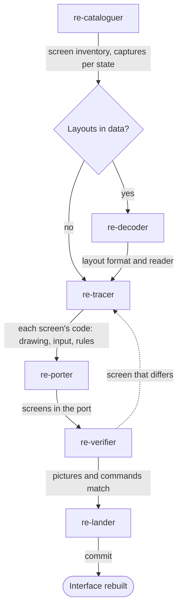

# Interface team

Use this team for the screens the player sees: menus, windows, the HUD, dialogs. It lists
every screen, captures each state, rebuilds the screens and compares them with the captures.

## Steps

| Order | Agent | Brief | Hands on |
|---|---|---|---|
| 1 | `re-cataloguer` | "Make the screen inventory" | One row per screen: how to reach it, its code or layout, states, inputs, text, font; captures in `derived/` |
| 2 | `re-decoder` (data-driven interfaces) | "Decode the layout format" | The layout format and a reader |
| 3 | `re-tracer` | "Trace &lt;screen&gt;'s drawing and input" | The screen's code: what it draws, what it reads, what commands it sends |
| 4 | `re-porter` | "Port &lt;screens&gt;" | The screens in the port, reading the game's state and sending commands |
| 5 | `re-verifier` | "Compare &lt;screens&gt; with the captures" | Pictures compared pixel for pixel (or with a threshold for streamed captures); the same commands |
| 6 | `re-lander` | "Land &lt;screens&gt;" | A commit |

## Outcome

- An inventory of every screen, so none is missed.
- Ported screens that match the captured pictures and send the same commands.
- Interface code kept apart from the game's rules, so tests can drive the rules without it.

## Choices for the main session

- Decide with the user how exact the interface must be ([Who drives](../games/interaction.md)),
  before `re-porter` starts.
- For a large interface, run steps 3 to 5 once per screen or group of screens.
