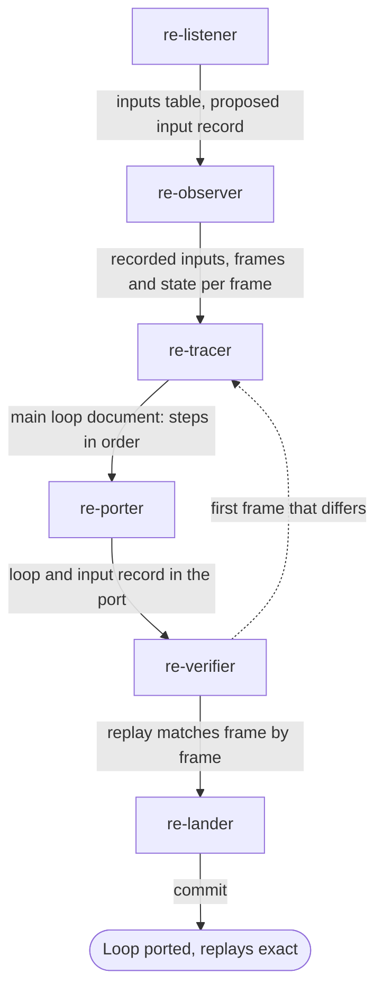

# Main loop team

Use this team for the frame or tick: the order of steps in the main loop, the input record,
and replays that reproduce a run exactly. Most other systems hang off the main loop, so this
team often runs early.

## Steps

| Order | Agent | Brief | Hands on |
|---|---|---|---|
| 1 | `re-listener` | "List every input and propose the input record" | The inputs table in `FINDINGS.md`; the record's fields |
| 2 | `re-observer` | "Record a demo or a scripted run with frames and state" | Inputs per frame, frames and state in `derived/` |
| 3 | `re-tracer` | "Trace the main loop's steps in order" | `docs/MAINLOOP.md`: each step with its address and its status |
| 4 | `re-porter` | "Port the loop and the input record" | The loop in the original's order; the record as the only way inputs reach the rules |
| 5 | `re-verifier` | "Replay the recording and compare every frame" | Identical state per frame, or the first frame and the first variable that differ |
| 6 | `re-lander` | "Land the main loop" | A commit |

## Outcome

- A list of every input from outside, with the address that reads each one.
- The main loop's steps in order, each traced and ported.
- A port that replays a recording from the original with identical state on every frame.

## Choices for the main session

- When the game has its own demo files, send `re-decoder` for the demo format before
  `re-observer` records anything.
- A long loop is ported one part at a time. Run steps 3 to 5 once per part, in the loop's
  order, as the Tyrian case study did ([Tyrian](../case-studies/tyrian.md)).
