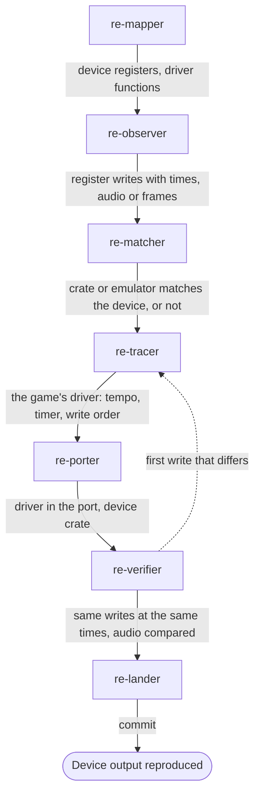

# Sound and hardware team

Use this team for a device the game drives directly: an FM sound chip, a sound card's digital
channel, a video mode with palette effects, a console's sound CPU. The port reproduces what the
player saw and heard, from the game's own register writes.

## Steps

| Order | Agent | Brief | Hands on |
|---|---|---|---|
| 1 | `re-mapper` | "Map the &lt;device&gt; registers and the driver functions" | Register labels; the driver's entry points named |
| 2 | `re-observer` | "Capture the &lt;device&gt; writes, with times, for &lt;songs or scenes&gt;" | A list of writes with times in `derived/`; audio or frames |
| 3 | `re-matcher` | "Compare &lt;crate&gt; with the device output" (for example `gameframe-opl2`) | Whether the crate gives the same output from the same writes |
| 4 | `re-tracer` | "Trace the game's &lt;device&gt; driver" | The driver's tempo, its timer, the order of its writes |
| 5 | `re-porter` | "Port the driver and use &lt;crate&gt;" | The game's driver in the port, writing to the device crate |
| 6 | `re-verifier` | "Compare the port's writes and output with the captures" | The same writes at the same times; then audio or frames compared |
| 7 | `re-lander` | "Land the &lt;device&gt; work" | A commit |

## Outcome

- The device's registers and the game's driver, named and documented.
- A port whose driver makes the same writes at the same times as the original.
- Output from a checked device implementation, compared with the captured audio or frames.

## Choices for the main session

- Choose the reference device with the user first, such as an AdLib or a Roland MT-32
  ([Sound](../hardware/sound.md)), and write it in the project's `AGENTS.md`.
- When no crate covers the device, `re-matcher` checks an existing emulator instead, or the
  team ports the device itself through `re-tracer` and `re-measurer`.
