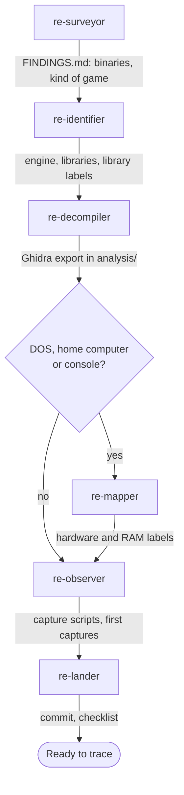

# Start-up team

Use this team on a new game. It takes the game's files and leaves a project that is ready for
tracing: the binaries are known, the engine and libraries are named, the code is exported, and
the original runs somewhere it can be captured.

## Steps

| Order | Agent | Brief | Hands on |
|---|---|---|---|
| 1 | `re-surveyor` | "Set up and inventory &lt;game&gt; from &lt;path&gt;" | `docs/FINDINGS.md` with the binaries table and the kind of game |
| 2 | `re-identifier` | "Identify the engine and libraries" | The engine, libraries and compiler in `FINDINGS.md`; library labels |
| 3 | `re-decompiler` | "Export &lt;binaries&gt; with the labels" | The Ghidra export in `analysis/` |
| 4 | `re-mapper` (DOS, home computer, console, arcade) | "Map the hardware and the main RAM variables" | Register and RAM labels; driver functions named |
| 5 | `re-observer` | "Run the original and capture the title screen and a demo" | A capture script; frames and state in `derived/` |
| 6 | `re-lander` | "Land the start-up work" | A commit; `CHECKLIST.md` lists the first subjects |

## Outcome

- `docs/FINDINGS.md` describes the game: binaries, engine, libraries, compiler, kind of game,
  time model.
- `analysis/` holds a labelled export that later agents search as text.
- A capture script runs the original and saves frames and state.
- `docs/CHECKLIST.md` names the first subjects. The usual first one is the random number
  generator, for the [exact system team](exact-system.md).

## Choices for the main session

- Skip `re-mapper` for a Windows game that reaches hardware only through DirectX or other
  APIs. List those imports in `FINDINGS.md` instead.
- If `re-identifier` finds an engine with released source, ask the user before any agent
  reads it ([Legal](../LEGAL.md)).
