# Working on a project

These pages describe how to organise the work of reverse engineering a game, for agents and
the people who direct them. The skills describe each step of the method. These pages cover the
work that spans several steps and several sessions.

- [Working well as an agent](agents.md): writing everything down in the repository, how to start a session,
  measuring before porting, working in subsystems, splitting work between sessions, what to
  do when stuck, and how to report.
- [Linux, cloud and container environments](environments.md): what an agent installs on Linux
  or in a cloud workspace, `scripts/env.sh` for each session, headless runs, REA, and game
  files on someone else's machine.
- [Getting more from Ghidra](ghidra.md): every call with its arguments, code that is not an
  executable, carrying labels to a new build, Function ID, types, processors.
- [Versions, patches and builds](versions.md): choosing the version to copy, comparing builds,
  and reading several versions' data in one port.
- [Building the port](building-the-port.md): the core and the platform layer, time, input,
  drawing, sound, the player's data, browser builds and round trips of the original's formats.
- [Practising on games with source](practice.md): practice targets, a ladder of exercises,
  and testing agents on games whose answers can be checked.
- [Keeping a game for the long term](preservation.md): archive packages, fixity with BagIt,
  format identification, and recording what was done.
- [Handling the game as evidence](evidence.md): identifying the copy, keeping it unchanged,
  tying each finding to it, and making each result repeatable.
- [Permissions and gates](gates.md): the commands an agent may run without asking, the ones
  that ask first, and the hooks that stop game material, decompiled code and stray commits.
- [Writing findings and documents](writing.md): plain English, the patterns to avoid, evidence
  labels, the structure of a findings document, commit messages.
