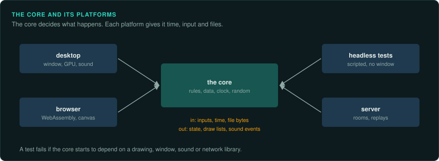
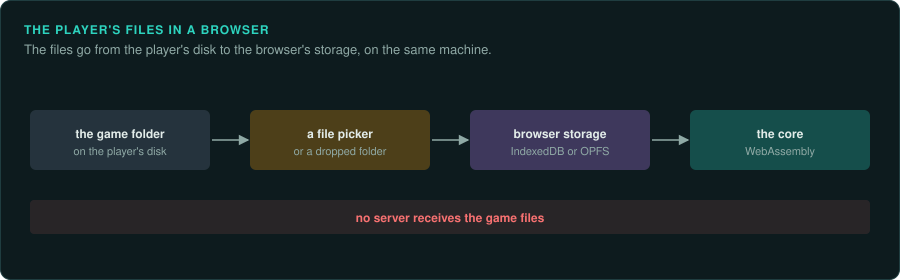
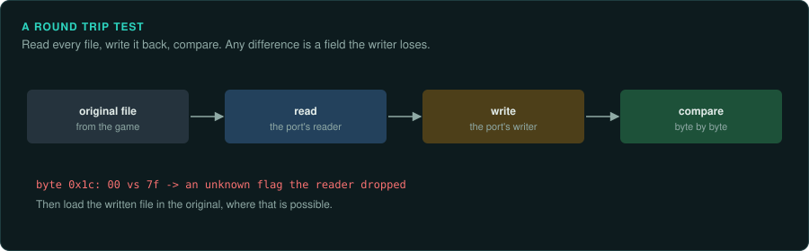

# Building the port

A reimplementation has two halves. The core is the game: its rules, its data formats and its
simulation, ported exactly. The platform layer is everything the original got from the
machine and the operating system: a window, drawing, sound, input, time, files. The core must
match the original bit for bit. The platform layer must behave the same as the original where
the player can see it, and can otherwise be built in any good modern way. This page covers that
split, each part of the platform layer, browser builds, and the player's data.
[re-port](../../.claude/skills/re-port/SKILL.md) covers porting the core, and [What a project
can ship](../OUTPUTS.md) the releases.

## The split

- **The core has no platform code.** It does no drawing, plays no sound, opens no window and
  reads no clock. It takes inputs and time from its caller and returns state, draw lists and
  sound events. This is what lets it run in tests, headless, in a browser, on a server and in
  a replay, with the same results everywhere.
- **The core reads data through an interface.** It is given bytes, or a reader for named
  files. It never searches the disk itself.
- **The platform layer is replaceable.** A desktop build, a browser build and a headless test
  harness are three platform layers around one core.
- **Additions sit outside the core.** New features talk to the core through a few documented
  entry points, so the core stays a faithful copy ([re-port](../../.claude/skills/re-port/SKILL.md)).

## The parts of the platform layer

| Part | What must match the original | What is free |
|---|---|---|
| Time | The fixed step, the tick rate, and what happens when a frame is late: catching up, slowing down, or dropping steps. Pausing when the window loses focus, if the original did | The clock used (a monotonic high-resolution clock), and how the frame rate is chosen |
| Input | When input is read in the frame, key repeat, the mapping of keys and buttons, mouse acceleration and scaling if the original applied its own, and the order of events in one frame ([Inputs](../observe/inputs.md)) | Support for new controllers and remapping, as additions |
| Drawing | The frames: what is drawn, in what order, with what blending ([Drawing](../observe/drawing.md), [Shaders](../hardware/shaders.md)) | The graphics API (wgpu, Vulkan, Metal, OpenGL, Direct3D), higher resolutions and wider screens as marked deviations |
| Sound | The sound logic: which sound plays when, its volume, pan and priority, the music's tempo and transitions. These belong in the core | The mixer, the output device, the latency, the sample rate, as long as the result sounds the same |
| Files | The formats the core reads, and where the original kept saves and settings, if players expect to find them there | How the player's files are found and stored |
| Text | The fonts and the layout, if the original drew its own text | Rendering at higher resolution |

## The player's data

A reimplementation ships no game data. It reads the player's own copy:

- **Find the copy.** Look in the usual places: Steam library folders (listed in Steam's
  `libraryfolders.vdf`), GOG's install folders, the original installer's default path, and a
  folder the player chooses. Remember the player's choice.
- **Check it.** Identify the version from file sizes or hashes, and tell the player clearly what
  was found and what is missing ([Versions](versions.md)).
- **Read it in place.** Prefer reading the original files to converting them. If a conversion
  makes loading faster, keep the converted files in the port's own folder and rebuild them when
  the originals change.
- **Never commit it.** Tests that need game data skip when it is missing. The repository's
  ignore file covers every folder that can hold it ([Legal](../LEGAL.md)).

## Browser builds

A core written in Rust, C or C++ compiles to WebAssembly and runs in the browser on the
player's files. Points to plan for:

- **Files.** The page asks for the game's folder or files (a file picker, a dropped folder, or
  the File System Access API where the browser has it), and keeps them in the browser's own
  storage (IndexedDB or the origin private file system). Nothing is uploaded.
- **The main loop.** The browser calls the page once per display frame (`requestAnimationFrame`).
  The port cannot block or wait, so loading and long jobs must be split into steps or moved to
  a worker.
- **Threads.** WebAssembly threads need shared memory, which needs the page to be served with
  cross-origin isolation headers. Without them, the port runs on one thread.
- **Memory.** 32-bit WebAssembly can use at most 4 GB, and less on some devices. Share assets
  between instances, free what is no longer needed, and measure.
- **Sound.** Browsers start audio only after the player clicks or presses a key. Start the
  audio context on the first input.
- **The same results.** Basic floating-point operations give the same results in WebAssembly
  as natively, but the maths library may differ. A core that uses its own copies of the
  original's maths functions computes the same game in both. Test it: run the same inputs
  natively and in the browser and compare the state.

## Writing the original's formats

Editors, mod tools and save converters write files in the original's formats. Prove each
writer with a round trip: read every file of that kind, write it back, and compare the bytes.
Every difference is a field the writer does not keep (padding, an unknown flag, a value
rounded on the way). Then load the written files in the original, where that is possible.

## Building and releasing

- Build for every system the project supports on each change, with continuous integration, and
  run the tests that need no game data there.
- Version the port separately from the game it copies, and show both where players look
  ([What a project can ship](../OUTPUTS.md)).
- Measure performance on the slowest system you support. Profile before changing anything,
  and check that an optimisation leaves the game's results unchanged.
