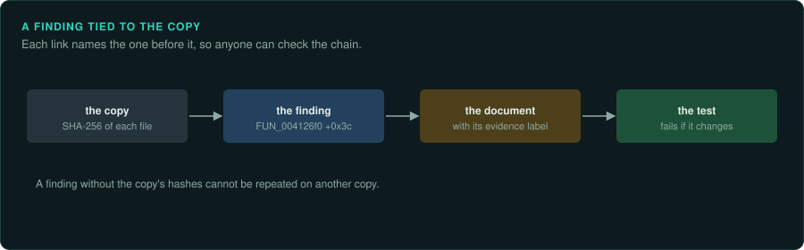

# Handling the game as evidence

Forensic examiners work so that another examiner, given the same material, reaches the same
result. A reverse-engineering project needs the same property. A finding is only useful when
someone else can check it on the same copy of the game. This page lists the habits that make
that possible. They cost little at the start of a project. They are hard to add later.

## Identify the copy before you work on it

- Record where the copy came from: the CD and its pressing, the store and the version or build
  number, the patch level.
- Hash every file before you change anything. `tools/triage/compare_trees.py DIR /dev/null --hashes`
  prints a SHA-256 for each file. Hashes are not game material, so they go in the repository
  (for example `docs/HASHES.txt`).
- For a CD, hash the image or each track, and compare with [Redump](http://redump.org/) where
  the disc is listed. That tells you which pressing you have ([CDs and DVDs](../media/discs.md)).
- When there are several releases, compare them (`compare_trees.py`, `tools/triage/similar.py`)
  and choose one to work from. Write down which one, and why.

## Keep the original unchanged

- Keep the installer, the image or the downloaded files as they came, and work on a copy in
  `target/`. Make the original read-only (`chmod -R a-w`).
- Never patch the copy you analyse. When a test needs a patched program, make a second copy,
  and record the patch and its reason.
- Write everything the tools produce into ignored folders (`analysis/`, `derived/`). Then the game's own files stay as they were. A hash check shows it.

## Tie each finding to the copy

A function address, an offset or a constant is true for one build. In another build it may
be different.

- Name the executable and its hash in `docs/FINDINGS.md`. Every address in the project refers to
  that build unless the text says otherwise.
- When a finding is checked on a second release, say so, and give that release's address.
- When a release changes, run `similar.py` on the old and new executables first. A score near
  100 means most findings may carry over. Check each one before you rely on it.

## Make every result repeatable

- Put the commands that produced a result in the repository: a script in `tools/` or
  `truth/`, or the command line in the finding.
- Record the versions of the tools that matter (Ghidra, the emulator, DOSBox-X). Tools change
  how they name and analyse things between versions.
- For measured evidence, record the inputs: the function, the arguments, the seed, the save
  file, the frame. [re-emulate](../../.claude/skills/re-emulate/SKILL.md) and
  [re-observe](../../.claude/skills/re-observe/SKILL.md) describe how.
- Label each claim as observed, measured, inferred or assumed ([Writing](writing.md)).

## Look before you run

Look at a file before you run it. Running an unknown installer or tool can change the machine
and the game's files. The order that keeps the most evidence is:

1. Read the files: kinds, signatures, entropy, strings, headers (`re-inventory`).
2. Extract installers and images without running them (`scripts/extract-installer.sh`).
3. Decompile and read the code (`re-ghidra`, `re-trace`).
4. Run single functions in an emulator (`re-emulate`).
5. Run the whole game where it is contained: an emulator, or a virtual machine without a
   network, with a snapshot taken first (`re-observe`).

## Build a timeline

Dates show how a release was made and which files belong together.

- The link time in each executable's header (`peinfo.py`), and version strings.
- The dates in the CD's volume descriptor and on each file (`discinfo.py --files`).
- The dates in archives and installers, and in the saves the game writes
  (`tools/formats/timestamps.py`).

Files with dates far apart from the rest were often patched later. FAT and Mac dates are local
time, so dates from machines in different time zones can be hours apart.

## Report so that others can check

A finding is ready when another person can follow it from the claim to the evidence without
asking you. It names the copy, the address or offset, the value, the tool and the command. It
says how sure it is. [Writing findings](writing.md) gives the structure.
