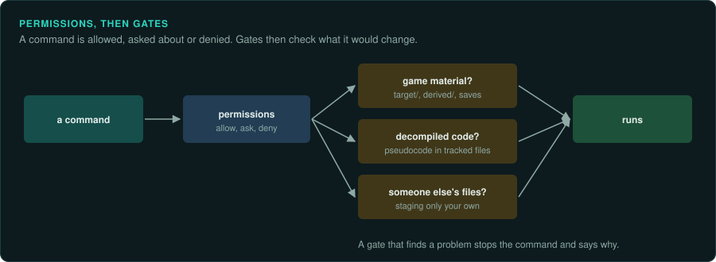

# Permissions and gates

GameFrame and every project made with `scripts/new-project.sh` come with a light set of
permissions and four hooks for Claude Code. They live in `.claude/settings.json`. The plugin
carries the same hooks in `hooks/hooks.json`. The aim is to let an agent work without a prompt
for each command it runs. The project's rules still hold for the few mistakes that cost the most.

Hooks are a safety net for honest mistakes. They are not a security boundary. An agent that
means to get around them can. The rules in `AGENTS.md` and the skills still apply in full.

## Permissions

Claude Code checks the deny list first, then the ask list, then the allow list. A command on
none of the lists follows the session's permission mode.

| List | Commands | Why |
|---|---|---|
| Allow | `./gameframe`, the scripts in `scripts/` (Ghidra export and run, DOSBox, the installer extractor, `setup.sh` without `--install`), `tests/run.sh`, the tools under `.venv/bin/python tools/` and `truth/` | The toolkit's own commands. They read the game and write only to ignored folders. |
| Allow | `git status`, `diff`, `log`, `show`, `add`, `commit`, `pull` | Every slice ends with a commit. The commit gate checks each one. |
| Ask | `git push` | A push publishes the work. The user sees each one. |
| Ask | `scripts/setup.sh --install`, `brew install`, `cargo install`, `npx -y rea-agents@6.4.0 setup`, `sudo`, `curl`, `wget` | These install software or download files. The project asks before any download. |
| Deny | `git add -f`, `git add --force`, `git push --force`, `git push -f` | A forced add is the usual way game material reaches git. A forced push can destroy another session's work. |

Everything else, such as reading files, running `cargo`, `objdump` or `python3`, is left to the
session's mode. The lists do not try to name every tool an agent may need.

## Gates

`scripts/hooks/gate.py` runs before some tool calls. A gate that blocks exits with status 2
and writes the reason on stderr. Claude Code shows the reason to the agent, which can then fix
the problem. In every other case the gate exits 0 and changes nothing.

| Gate | When | It blocks |
|---|---|---|
| `commit` | Before `git commit` | Staged files in `target/`, `analysis/`, `derived/`, `game-data/` or `save-game/`. Staged game binaries and data files (`.exe`, `.dll`, `.ovl`, `.pkg`, `.sav`, `.wad`, `.pak`, ROM images and others). Added lines that look like Ghidra's decompiled code. A commit made by a GameFrame agent other than `re-lander`. |
| `push` | Before `git push` | A push made by a GameFrame agent other than `re-lander`. |
| `write` | Before Write and Edit | Writing two or more lines of decompiled code into a file outside `analysis/`, `derived/` and `target/`. |
| `session` | When a session starts | Nothing. It adds a short note to the session: whether `.env`, `.venv` and the Ghidra export exist, and the next three open items in `docs/CHECKLIST.md`. |

The `commit` gate also checks `git commit -a`, which stages tracked changes as it commits.

### What counts as decompiled code

Ghidra's decompiler writes names and forms that people do not write by hand: `undefined4`,
`CONCAT44(`, `SUB41(`, `ZEXT14(`, `(**(code **)`, `/* WARNING: `, and variables such as
`unaff_EBX`, `in_stack_00000008` and `extraout_EAX`. The gates look for these. One such line
can appear in prose that explains a type. Two or more lines in one write or one commit are
blocked.

Function addresses such as `FUN_1400be770`, offsets such as `+0x44` and constants pass. They are
how findings cite the original.

### Which agents may commit

Only `re-lander` commits and pushes. The other stage and task agents end with a hand-off that
names the next agent. When an agent such as `re-tracer` tries to commit, the gate tells it to
hand off to `re-lander`. The main session is not an agent, so it can commit and push. The
permissions still ask before a push.

## Changing them

Put personal additions in `.claude/settings.local.json`, which git ignores. Claude Code merges
its lists with the ones in `.claude/settings.json`. An entry there can allow more commands. It
cannot undo an ask or a deny entry from the shared file, because deny and ask are checked first.
To change those for everyone, edit `.claude/settings.json` in the project. To turn a gate off
for one project, remove its entry from the `hooks` section.

When a gate blocks something that is correct, change the gate rather than working around it.
Add a test for the case to `tests/run.sh`, in the section named "Gates".
