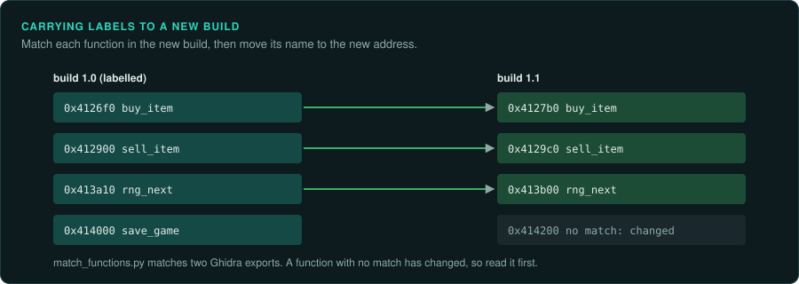

# Getting more from Ghidra

The [re-ghidra](../../.claude/skills/re-ghidra/SKILL.md) skill covers the daily work: export a
binary once, query the text, decompile single addresses, apply labels. This page covers the
techniques for larger questions. Some cover a whole program at once. Others carry work from one
build to the next, or handle code that is not an ordinary executable.

## Every call to a function, with its arguments

`ExportCallArgs.java` lists every call to chosen functions. For each call it gives the
arguments the decompiler can reduce to a constant, a string or a global. It reads Ghidra's
P-Code, the processor-independent form the decompiler works on. It therefore works the same
way for x86, 68000, MIPS and every other processor Ghidra supports.

```bash
scripts/ghidra-run.sh game.exe callargs analysis/notes/sounds.tsv PlaySound play_sfx
scripts/ghidra-run.sh game.exe callargs analysis/notes/files.tsv fopen CreateFileA open_resource
scripts/ghidra-run.sh game.exe callargs analysis/notes/random.tsv rng_next random_range
```

One run answers questions such as these:
- every sound the game plays and the id it passes;
- every file it opens by name;
- every random draw and its range;
- every message box and its text.

Arguments that are not constant show as the variable's name. A pointer to a local variable
shows as `&local`. Follow those in the calling function.

## Code that is not an executable file

A booter game's load map, an unpacked memory dump, a console ROM with banks, or overlays that
the game loads at run time have no header to tell Ghidra where they go. `AddMemoryBlocks.java`
builds the memory from a map of pieces. Each line of the map gives a file, an address, an
optional offset and length, a name, and `code` to disassemble from the piece's start.

```text
# derived/loadmap.tsv: file, address, offset, length, name, code
boot.bin	0000:7c00	0	0x200	boot	code
disk1.img	1000:0000	0x2400	0x9000	game	code
disk1.img	2000:0000	0xb400	0x4000	data
```

```bash
analyzeHeadless analysis/raw re -import derived/boot.bin -loader BinaryLoader \
  -loader-baseAddr 0000:7c00 -processor "x86:LE:16:Real Mode" \
  -scriptPath tools/ghidra -postScript AddMemoryBlocks.java derived/blocks.txt derived/loadmap.tsv \
  -postScript ExportAll.java analysis/export
```

A piece that overlaps an existing block becomes an overlay. This suits code banks that share
an address range. The script analyses the new blocks. `ExportAll.java` then writes the usual
text export. [Floppy disks and booter games](../media/floppies.md) describes how to make the
load map.

## Carrying labels to a new build



When a patch or another release arrives, the addresses move. Most functions stay the same.
`tools/triage/match_functions.py` compares two exports and matches the functions. It uses the
same pseudocode once addresses are removed, shared pieces of pseudocode, and the order of
calls from matched functions. Then it writes your labels at the new addresses:

```bash
scripts/ghidra-export.sh --out analysis/export-v12 target/v12/game.exe
python3 tools/triage/match_functions.py analysis/export/game.exe analysis/export-v12/game.exe \
    --labels labels/names.tsv --out labels/names-v12.tsv
```

Each label it writes records how it matched and with what score. Review the fuzzy matches your
port depends on before you apply the file with `ghidra-run.sh labels`. The same command
compared with a known library's export finds the library functions in a game. With the sample
game, it matches the C runtime functions shared by the executable and its DLL.

Ghidra has two heavier tools for the same job. **Version Tracking** compares two programs
inside Ghidra, with several correlators, and carries names, comments and types across. **BSim**
stores a feature vector of each function in a database and finds similar functions across
many programs, even built for other processors. BSim can keep its database in a local file,
so it needs no database server for one person's work. Use them when the text comparison is
not enough. Examples are a different compiler, a different optimisation level, or many
releases at once.

## Naming library code with Function ID

Ghidra's Function ID names functions by hashing their instructions and comparing them with
databases of known libraries. Ghidra ships databases for common Visual Studio runtimes. For
another compiler of the era, such as Watcom, Borland or an old Visual C++, build a database
yourself. Analyse the library's own `.lib` files or a program built with them, and create a
Function ID database from those programs with the Function ID plug-in. Then apply it to the
game. The names it gives can go into the labels file, with "Function ID" as the evidence.

## Types for the port

Once the structures of the game are typed in Ghidra, export them as a C header from the Data
Type Manager. The header gives each field's offset and type in one place, which helps when you
write the port's own types. Keep the header in `analysis/` if it includes the original's
names from symbols. Write the port's types in your own words ([Legal](../LEGAL.md)).

## Processors Ghidra does not know

Ghidra describes each processor in SLEIGH, a language for instruction sets. The community has
written modules for many processors of the era that Ghidra lacks. [Console tools](../consoles/tools.md)
lists the ones for consoles. When none exists, writing one is a large job. A loader for a format is a smaller job. So is a memory map for `AddMemoryBlocks.java`. Both are often
enough when the processor itself is supported.

## Scripts and headless runs

Every GameFrame Ghidra script runs headless through `scripts/ghidra-run.sh`, on an analysed
project, without analysing again. A new question that needs the whole program is usually a
short script in `tools/ghidra/`. Start from the closest existing script, write its output as
text, and give it a mode in `ghidra-run.sh` so agents can find it with `gameframe tools`.
