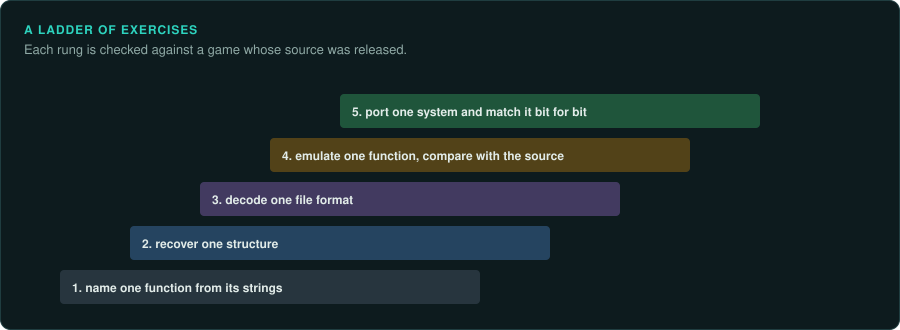

# Practising on games with source

Reverse engineering is learned on targets where the answer can be checked. A game whose source
code is public is such a target. Work out a feature from the binary alone, then read the
source to see what you got right. This page lists practice targets and a ladder of exercises,
for people and for agents. It is also a way to test a new skill or agent before it meets a
game with no source.

## Practice targets

| Game | What is public | Notes |
|---|---|---|
| GameFrame's sample games (`examples/`) | Source, a build script, ground truth | Built for practice: an RNG, a vtable, a data file, a fixed-step loop, a 16-bit DOS program |
| Wolfenstein 3D, Doom, Quake (id Software) | Engine source under the GPL; shareware episodes free to share | Ray casting, BSP, fixed point, WAD and PAK files. Many source ports document the formats |
| Duke Nukem 3D (3D Realms) | Engine and game source under the GPL; a shareware episode | The Build engine, the CON scripts, GRP files |
| The Battle for Wesnoth | Full source under the GPL | A turn-based strategy game with a client and a server: good for protocol work |
| AssaultCube | Source under the zlib licence; game data under its own terms | A small first-person shooter with a simple network protocol |

Use an official binary that matches the source release, so that the code you read is the code
that runs. Build it yourself only when you need symbols to check against. Follow each game's
licence for its data, as for any game.

## A ladder of exercises

1. **Identify.** The compiler, the libraries and the engine (`re-inventory`). Check against the
   build files in the source.
2. **The main loop.** Find it from the entry point and list the systems it calls in order.
3. **The random generator.** Find it by its constants (`tools/triage/constants.py`), measure
   it under emulation, and port it. Check the formula in the source.
4. **A data format.** Decode one file type with `re-format`, proven on every file. Check against
   the loader in the source.
5. **A save file.** Decode the save, then change one value and load it.
6. **One rule.** Trace one game rule (damage, movement, an AI decision) to the exact formula and
   order of operations. Check each step in the source.
7. **A frame.** Reproduce one drawing routine and compare its output with the original's
   frame buffer ([Pixel-exact software rendering](../hardware/software-rendering.md)).

Write the findings in the evidence style before reading the source. Then mark each claim as
confirmed, wrong or incomplete. The wrong ones show which step of the method needs more care.

## For agents

A practice target is a test of an agent. Give it a step from the ladder and the binary, with
the source out of reach. Then compare its findings with the source. Record how many claims
were right, how many were labelled correctly as inferred, and which were wrong. Repeat after
changing a skill or an agent's brief. [Agent teams](../teams/README.md) describes the agents.
