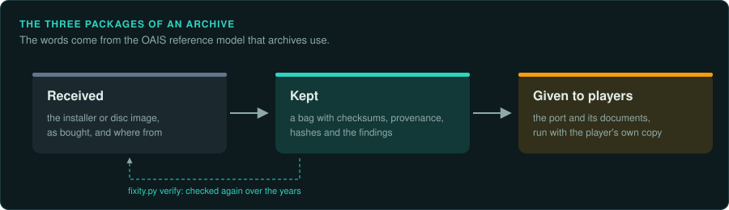

# Keeping a game for the long term

Libraries and archives have a vocabulary and a set of habits for keeping digital material
usable for decades. Two parts of this vocabulary matter here. The OAIS reference model (ISO
14721) names the packages and the roles. BagIt (RFC 8493) is a common way to package files
with their checksums. This page maps those habits onto a GameFrame project. The project then
keeps the game itself, and the knowledge gained about it, for as long as possible.
[Game preservation](../preservation/README.md) covers why games disappear.

## Three packages



The OAIS model names the package received from a producer (the submission package), the
package the archive keeps (the archival package), and the package it gives to users (the
dissemination package). In a game project:

| Package | In a GameFrame project | Where |
|---|---|---|
| Received | The installer, the disc image or the files, as bought, with where they came from | The original download or image, untouched |
| Kept | A bag of the received files with checksums, the hashes of every file, the provenance record, and the findings | A bag outside git (`tools/triage/fixity.py bag`), plus the repository |
| Given to users | The port, its documentation, and instructions that work with the player's own copy | The repository and its releases |

The port is one way to keep the game playable. Running the original in an emulator is
another. Libraries call these migration and emulation. Keep what both need: the original's
files, the emulator settings that run them, and the port.

## Fixity: knowing nothing changed



```bash
python3 tools/triage/fixity.py bag ~/Downloads/game-setup derived/bags/game-1.2 \
    --info "External-Description=GOG release 1.2, installer setup_game_1.2.exe" \
    --info "Source-Organization=bought from GOG on 2026-10-01"
python3 tools/triage/fixity.py verify derived/bags/game-1.2
python3 tools/triage/fixity.py manifest target/game          # checksums of the working copy, in place
```

- Make a bag of each copy as received, before anything else. The checksums prove later that
  a file is still exactly what it was.
- Check the bag now and then: after moving it, when a disk is replaced, once a year. Storage
  fails slowly and silently.
- Keep more than one copy in more than one place. A copy on the same disk as the original is
  not a second copy.
- Record the checksums in the repository too (`compare_trees.py --hashes`). They are not game
  material, and every finding can name the copy it was made on
  ([Handling the game as evidence](evidence.md)).

## Knowing what the files are

Archives identify each file's format against a registry, so they know which files will need
attention as software changes. The UK National Archives' PRONOM registry and the tools that
use it, DROID and Siegfried, identify common formats: images, sound, video, documents and
archives. Most game formats are not in PRONOM. Identify them with the game's own code
(`re-format`) and record each format in `docs/FINDINGS.md`: name, signature, the code that
reads it, and its decoder. The project is then the documentation that a registry lacks.

## Recording what was done

Preservation metadata records events: what was done to which file, when, with what tool, and
with what result. Keep the same record. Note each extraction, conversion and repair with its
command and tool version, in the findings or the commit messages. Someone in twenty years
should be able to repeat each step, or see why it was done.

## Planning for change

- Prefer open, documented formats for anything the project produces: PNG, WAV, plain text,
  JSON.
- Keep the tools' versions in the repository's setup (`scripts/setup.sh`), so the work can be
  rebuilt.
- Write findings in plain language, as the writing rules ask. Prose outlives the tools that
  produced it ([Writing findings](writing.md)).
