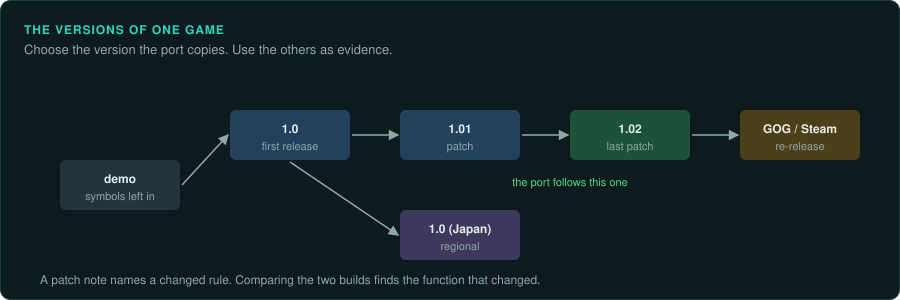

# Versions, patches and builds

Most games exist in several versions: the first release, patches, regional releases, budget
re-releases, digital store builds, ports to other systems, and demos. They differ in rules,
bugs, data and code. A reimplementation must choose which version it copies, and it can use
the other versions as evidence. This page covers choosing the version, comparing builds,
and keeping a port faithful to one version while it reads the data of several.

## Choosing the version

Decide this at the start and record the decision in the project's evidence log:

- **The version players have.** Usually the last official patch, or the version sold today in
  digital stores. Players expect the port to read their copy.
- **The version the community plays.** Speedrunners and competitive players often prefer one
  release for its bugs or timing. If the port is for them, copy that one.
- **The most complete version.** A later edition may add content and fix bugs, but it may also
  change rules.
- **The version with the most evidence.** A build with symbols or debug information is the
  easiest to study, even if the port then follows a different build. Study one and port
  another only where the code is the same, and check each difference.

Record the exact build: the file hashes (`tools/triage/compare_trees.py` and
`tools/triage/fixity.py`), the version string, and the build number the game shows.

## Comparing two builds

| Question | How |
|---|---|
| Which files changed? | `tools/triage/compare_trees.py OLD NEW` compares two copies file by file. `--similar` says how much of each changed file is shared, and pairs files that were renamed |
| How much of a file changed? | `tools/triage/similar.py` measures what two binaries share, even when everything has moved |
| Which functions are the same? | `tools/triage/match_functions.py` matches the functions of two Ghidra exports and carries your labels to the new build. BinDiff and Diaphora do the same inside a disassembler |
| What changed in one function? | Compare the two pseudocode listings. Most changes are a constant, a new condition or a new call |
| What did the developers say changed? | Patch notes and readme files. Each line is a lead: find the function it describes in both builds |

A patch note such as "fixed archers firing through walls" names a rule and gives two builds that
differ in it. Comparing the two functions shows the original rule and the fix. The chosen version
decides which of the two the port has.

## One port, several versions

A port may need to read the data of several versions even when it copies the rules of one:

- Detect the version from the files the player gives it (file sizes, hashes, a version string),
  and tell the player which version was found.
- Keep the rules of the chosen version. Where another version differs and the project wants it,
  add it as an option, marked as a deviation, never silently.
- Saves from different versions may differ. Test the port with saves from each version it
  claims to read.

## Demos and prototypes

Demos, betas and prototypes are builds too. They often ship with debug symbols, logging or
debug menus that the release removed, and their code is often close to the release. Use them as
evidence, matched to the release with `match_functions.py`, and keep their material in the
project's ignored folders, like any game material ([Legal](../LEGAL.md)).
