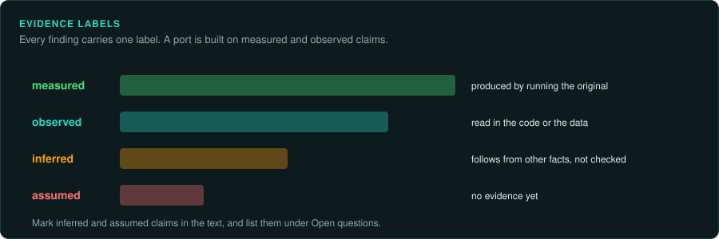

# Writing findings and documents

Everything in GameFrame is written to be read by agents and people, and to be translated.
This page sets the style for findings, documents, skills, commit messages and posts. Follow it
in every project made with GameFrame.

## Plain English

- Write short sentences with one idea each.
- Use common words. Prefer "use" to "utilise", "start" to "commence", "find" to "ascertain".
- Name the subject of each sentence. Write "the loader reads the header", and avoid "the header
  is then read".
- Give the evidence in the same sentence as the claim: an address, an offset, a value, a file.
- Write numbers with their units and their base: `0x44`, 70 Hz, 16.16 fixed point.
- Before you finish a paragraph, imagine it translated into another language word by word.
  If the translation would confuse a reader, rewrite the English.

## Patterns to avoid

These patterns make text sound written by a machine. They also hide the facts. Search for each one before you finish. Rewrite what you find.

| Pattern | Example | Rewrite |
|---|---|---|
| A summary that reveals its content after a colon | "Two rules hold it together: every claim rests on evidence, and every number is measured." | "Give the evidence for every claim. Measure every number the port must match." |
| A closing contrast "X, not Y" | "Numbers are measured, not guessed." | "Numbers are measured by running the original code." |
| Matched pairs and triplets for rhythm | "the same loop and the same discipline"; "bit for bit, draw for draw, frame for frame" | Say the one thing that is true: "the same steps"; "bit for bit" |
| Two clauses of the same shape joined by ", and" | "A takeover game must be traced at its register writes, and its port must rebuild what the chips did." | Two sentences: "Trace a takeover game at its register writes. The port must rebuild what the chips did." |
| Clauses chained with "and the ..." | "It reads the file and the header and the table." | Separate sentences, or a list |
| Signposts | "Here is how it works." "Three things stand out." | Start with the first fact |
| Metaphors and figures of speech | "the beating heart of the engine", "a door that opens" | The literal statement: "the main loop", "a function the mod can call" |
| Dramatic openings | "Nobody knew why the save broke." | "The save broke because ..." |
| Hedging filler | "It is worth noting that", "Essentially", "In order to" | Delete the words |
| Abstract statements | "In each of these cases the game that players bought survives longest." | "When a studio loses its source code, the copies players bought are often all that is left." |

A contrast is fine when it prevents a real mistake. "Keep the constant as `0.33333331f`, as
read from the binary. Do not write `1.0 / 3.0`." That warning names the wrong thing the reader
would otherwise do.

A colon is fine when it introduces a list or an example. "The header has three fields: the
magic, the version and the entry count."

## Evidence labels

Every claim carries one of these labels, in the text or in a table column.

| Label | Meaning | Example |
|---|---|---|
| *observed* | Read in the code or the data | "`FUN_1400be680` multiplies by 0.75 (*observed*)" |
| *measured* | Produced by running the original, with the inputs named | "3,000 names from seed 1 match (*measured*)" |
| *inferred* | A reasoned guess; say what would confirm it | "`+0x44` is probably the age (*inferred*: it rises once a year)" |
| *unknown* | An open question | Listed under **Open questions** |

Never write that the game "does" something at run time from a static reading alone.

## Structure of a findings document

1. An opening paragraph: what the document covers and what kind of evidence it rests on.
2. Tables keyed by address, offset or file, with a column for the evidence.
3. Prose for the order of events and the reasons, one step per sentence.
4. **Open questions** at the end.

Never paste decompiled code, disassembly or the game's data into a document. Describe them in
your own words, with addresses and constants ([Legal](../LEGAL.md)).

## Commit messages

- The subject says what changed, in the imperative, at most 72 characters.
- The body says what was traced or ported, from which functions, and how it was verified.
- The same style rules apply. A commit message is read by the next session.
